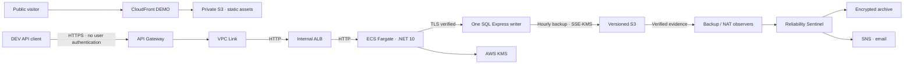

# AWS Cloud Resilience Laboratory · ECS V2

A working .NET 10 application on ECS Fargate, backed by SQL Server Express and
AWS KMS, with measured recovery experiments and an independent reliability monitor.
The project explores how a small, cost-conscious platform can recover from failures
without a permanently running standby database.

**[Open the public DEMO](https://d20ioz705caon7.cloudfront.net/)** ·
[Architecture Explorer](https://d20ioz705caon7.cloudfront.net/architecture) ·
[Resilience Lab](https://d20ioz705caon7.cloudfront.net/resilience) ·
[Engineering documentation](docs/README.md)

The public site uses synthetic data and historical evidence. It runs independently
of the temporary AWS laboratory and makes no requests to its backend.

## What the platform does

The API accepts text, encrypts it with KMS, stores the ciphertext in SQL and
decrypts it on retrieval. Private workloads use two NAT instances, one per AZ.
Hourly verified backups support supervised recovery into a newly provisioned SQL
host. Reliability Sentinel observes backups and private HTTPS egress, persists
incident progress, archives evidence and delivers notifications through separate
durable effects.



The [seven-view V2 atlas](docs/interactive/V2-INDEX.md) explains networking, NAT
recovery, Sentinel internals, SQL recovery, trust boundaries and deployment
ownership. It distinguishes implementation, installed resources, demonstrated
behavior and historical capabilities. The five older Archify views remain a
separate historical collection.

## Demonstrated in AWS DEV

| Capability | Result and evidence |
| --- | --- |
| Application | Real browser → API Gateway → Fargate → SQL/KMS, POST/GET and liveness/readiness. [Application evidence](docs/DEV-V2-20261105.md), [browser evidence](portfolio/product/VALIDATION-PR36.md). |
| Cold SQL recovery | New EC2 in another AZ: **41m31.5s**; new EC2 in the same AZ: **24m42.6s**. Includes source fencing, provisioning, restore, CHECKDB, handoff and API read/write/decrypt. [Measured trials](docs/V2-RECOVERY-SECURITY-20261105.md#cold-recovery-execution--6-november-utc). |
| NAT recovery | Final NAT A trial: failure persisted after **59.115s**, HTTPS restored after **2m29.191s**. ASG replaced the instance; E13 restored EIP, route and SDC. [Incident timeline](docs/SENTINEL-CHAOS-20261106.md#installed-correction-and-third-separately-authorized-trial). |
| Backup monitoring | A genuine producer fault caused freshness breach, escalation and resolution after recovery. Exact-version S3 verification, encrypted archives and inbox receipt were correlated. [Sentinel evidence](docs/SENTINEL-CHAOS-20261106.md). |
| Remote retention | Seven-day Lifecycle admission for verified superseded backup pairs; two newest valid pairs and historical prefixes preserved. Rules/admission verified; future expiration is not a completed deletion test. |
| Public portfolio | HTTPS DEMO with twelve isolated diagrams, mobile/desktop browser tests, reproducible assets and private S3/OAC. [Hosting and validation](portfolio/product/VALIDATION.md). |

These are dated, supervised DEV results, **not SLAs**. Cold SQL recovery is not
automatic failover. Planned final backups do not establish zero RPO for abrupt
failure. There is one SQL writer and one active application task; two AZs do not
make the entire service highly available.

## Reliability Sentinel

Regional observers verify backup objects and NAT control-plane/HTTPS evidence.
EventBridge and SQS feed ingestion; DynamoDB holds observations, incidents and
the journal. A bounded worker evaluates work, checkpoints progress, archives
evidence with SSE-KMS and publishes SNS notifications. The watchdog independently
checks progress and exposes delivery/backlog failures.

The profile remains **64 requests / four jobs**. Four historical permanent
failures and their verified compensations remain visible. Sentinel observes and
notifies; ASG/E13 repairs NAT, and an operator supervises SQL recovery.
[Runtime implementation](operations/integrations/portable/README.md) ·
[Current audit and monitoring boundary](docs/ENGINEERING-REVIEW.md).

## Repository map

| Location | Responsibility |
| --- | --- |
| `demo-api/` | .NET API, tests, strict SQL profile and image recipes |
| `terraform/modules/target/dev/` | Native Terraform owners: network, SQL, ECS skeletons and edge |
| `terraform/live/security/` | Protected IAM, keys, secret metadata and administrative resources |
| `operations/sql-backup/` | Producer, verification, host installation and supervised recovery |
| `operations/integrations/portable/` | Sentinel runtime, observers, retention and isolated Terraform owner |
| `portfolio/product/` | Dependency-free web product, supervised local AWS adapter and static hosting |
| `docs/interactive/` | Editable sources, pinned Archify output, provenance and reading sheets |
| `.github/`, `scripts/`, `ci/authority/` | CI, deployment contracts and executable authority controls |

Terraform owns infrastructure skeletons. Delivery owns task revisions/counts and
ALB forwarding. NAT handlers own private default-route repair. Secret values are
written confidentially outside Terraform; checked-in configuration contains metadata.

## Run locally

The DEMO needs Node 22+ and no AWS account or dependency installation:

```sh
node portfolio/product/server.mjs
# Open http://127.0.0.1:4182/
node --test portfolio/test-contract.mjs
```

For application development, use the SDK pinned in `global.json` (10.0.402):

```sh
dotnet restore demo-api/terragrunt-demo.sln --locked-mode
dotnet build demo-api/terragrunt-demo.sln -c Release --no-restore
dotnet test demo-api/terragrunt-demo.sln -c Release --no-build
```

Tests use isolated dependencies; they do not establish live SQL/KMS health. To
run the real HTTP application, provide private `DB_CONN_STRING` and `KMS_KEY_ID`,
the strict SQL certificate trust and runtime AWS credentials. Follow the
[SQL security contract](terraform/docs/sql-runtime-security.md) and
[application guidance](demo-api/AGENTS.md). Never place migration credentials in
the HTTP process. Startup migrations default off. The
[local AWS Edition](portfolio/product/README.md#aws-edition-uso-autorizado-y-temporal)
is an explicit, expiring loopback session, not public backend authentication.

## Operation, validation and limits

- [Native DEV lifecycle](terraform/docs/native-dev-lifecycle.md): authoritative
  runtime procedure; E16 is retired. Plans and destructive operations have real
  effects and require current identity, inputs, locks, retention and authorization.
- [Cold recovery runbook](operations/sql-backup/recovery/NATIVE-RECOVERY.md):
  positive source fencing, one active writer and retained encrypted disks.
- [CI/CD review](docs/CI-CD-REVIEW.md): CI is active; automatic CD is disabled.
  V2 used supervised native delivery. Historical V1 A→B→A proves that earlier
  bound deployment, not a working main-based V2 delivery pipeline.
- [Technical audit](docs/ENGINEERING-REVIEW.md): security findings, current readbacks,
  recovery guarantees, costs and closure. [Validation guide](terraform/docs/validation.md)
  separates offline checks from AWS effects.

The DEV API is public and unauthenticated, internal ALB hops use HTTP, and SQL is
a recoverable single node. There is no PITR chain, region-wide recovery proof or
production security certification. Auxiliary image vulnerabilities and incomplete
object-access auditing remain material debt. Public examples contain synthetic data.

Laboratory retirement is reserved for **9 November 2026, 02:30–04:00 UTC**;
permission expiry does not stop billing. The independent CloudFront DEMO has a
separate USD 1/month reserve. Models are not AWS spending caps. Retained disks,
backups, keys, secrets and evidence require explicit disposition after compute stops.

## Credits

Created by **Kendall Fernandez**, Costa Rica · [LinkedIn](https://www.linkedin.com/in/kendall-fernandez-fernandez-b4930b174) ·
[Contact](mailto:kendallffernandez@gmail.com).
No repository-wide software license is currently declared. Third-party licenses
remain attached to their assets. Diagram provenance, Archify 3.1.0
pins and historical sources are retained in the [atlas documentation](docs/interactive/README.md).
Font licenses and reviewed design-tool provenance remain with the [web product](portfolio/product/README.md).

<!-- Temporary negative governance test: removed before integration. -->
[Required-check negative test](docs/governance-negative-test-intentionally-missing.md)
