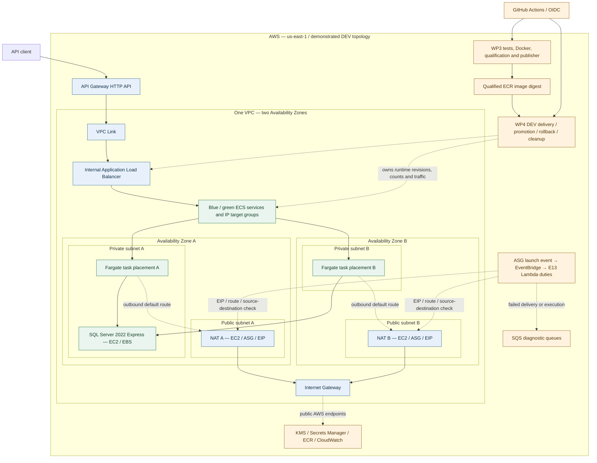

# terragrunt_demo — AWS infrastructure and delivery, proven end to end

A personal AWS/DevOps portfolio project: provision the **original full DEV
architecture**, deploy a .NET application, qualify and deliver immutable images,
exercise blue/green and rollback, recover NAT instances, then destroy the runtime.
Terraform/Terragrunt, GitHub Actions and AWS OIDC support one supervised operator.

**V1 runtime closure - 2026-10-16:** two full DEV deployments, application SQL/KMS
checks, protected CI/CD, distinct-image rollback and per-slot NAT recovery were
verified in AWS. Final DOWN completed. A fresh read-only audit confirmed five
empty DEV states, no locks and no surviving DEV runtime compute or networking.
The API is **offline**. Retained security, artifacts and storage can still incur
charges; see [closure inventory and operations](terraform/docs/portfolio-operations.md).
This repository is a demonstrated DEV system, not a production availability claim.

V2 continues locally. The owner-authorized .NET 10 LTS migration uses SDK
10.0.402 and runtime 10.0.13, with [local qualification](terraform/docs/validation.md#net-10-lts-local-migration---2026-10-16).
The dated AWS trials above used V1; .NET 10 API has not been deployed to AWS.
The [V2 backup/restore increment](operations/sql-backup/README.md) has native
Express and real S3/KMS component evidence. The .NET 10 backup CLI also passed
one manual and two actual hourly EC2-role jobs on October 21; its temporary
runtime was retired and the residual network closed that evening. Cross-AZ
SQL/API recovery and measured RPO/RTO remain pending. The
[isolated recovery packet](operations/sql-backup/recovery/RUNBOOK.md) is local
preparation only; it does not authorize or prove another AWS session.

## Architecture demonstrated

Task placement spans the two private subnets; this diagram does not promise one
permanent task in each AZ. Blue/green means two services, with only the serving
color kept running between deliveries. SQL is a **single EC2 instance**, not an
HA database. NAT recovery replaces a failed instance **within its slot/AZ**;
it does not prove cross-AZ failover or uninterrupted outbound connectivity.
No Cloud Map registration is implemented.

The .NET 10 LTS API encrypts text with KMS, stores ciphertext in SQL Server and decrypts
it on retrieval. `/health` is liveness; `/ready` checks database/KMS readiness;
POST/GET `/text` exercises the actual data path. Application and SQL instances
are private. VPC Link reaches the internal ALB; no public SQL or SSH ingress is
required. NAT provides outbound access for private workloads.

## Infrastructure and ownership

Terraform/Terragrunt separate the runtime into five states:

| Creation order | Layer | Main responsibility |
| --- | --- | --- |
| 1 | `global` | VPC, four subnets, routing, IGW, EIPs, both NAT ASG slots, ALB/target groups |
| 2 | `data` | SQL EC2 and its encrypted disposable EBS |
| 3 | `platform` | ECS cluster |
| 4 | `apps` | Blue/green service skeletons and application log groups |
| 5 | `edge` | API Gateway, VPC Link and edge logging |

DOWN reverses this order. The separately protected security root, S3 state
backends/versions, KMS/secrets, ECR, identities and release evidence are retained.
E16 grants one operator exclusive write authority over the five DEV state/lock
pairs. Terraform owns skeletons; WP4 owns task revisions, desired counts and ALB
traffic. Protected delivery does not acquire Terraform state-write authority.

## CI/CD and verified results

GitHub Actions obtains temporary AWS credentials through **OIDC**, without
permanent AWS access keys in GitHub. WP3 qualifies source through seven controls,
.NET tests and Docker/probe checks, then publishes through its authorized ECR
publisher. WP4 consumes a qualified release/digest, verifies readiness, promotes
traffic and automatically drains the old color. Rollback recreates the previous
qualified image rather than relabeling the current one.

| Demonstration | Authentic evidence / scope |
| --- | --- |
| Rebuild after DOWN | Second full original DEV UP reconstructed resources with new IDs; [deployment record](terraform/docs/second-real-dev-cycle.md) |
| Qualification | [WP3 run 38825575655](https://github.com/Kendall04/terragrunt_demo/actions/runs/38825575655): seven controls passed, 103 .NET tests, real Docker/probe and ECR publication |
| Blue/green delivery | [WP4 run 38825984998](https://github.com/Kendall04/terragrunt_demo/actions/runs/38825984998): distinct digest B served traffic; automatic cleanup |
| Real A → B → A rollback | [Run 38827037528](https://github.com/Kendall04/terragrunt_demo/actions/runs/38827037528): original digest A restored, SQL/KMS round trips passed, cleanup automatic, E2 generation 14 RELEASED |
| NAT replacement | Both slots recovered with E13 and real private egress; the initial B failure and its manual repair remain distinguished from the successful corrected automatic retrial in the [NAT record](terraform/docs/e13-nat-reliability.md#installed-dev-correction-and-automatic-b-retrial) |
| Final runtime removal | Five reviewed saved plans applied; independent AWS removal checks and retained-resource inventory in the [final DOWN record](terraform/docs/e16-practical-dev-lifecycle.md#final-real-dev-down-completed--2026-10-16-utc) |

[Delivery evidence](terraform/docs/deployment.md#real-sourcetransport-qualification-and-distinct-digest-dev-rollback)
records complete releases and digests. Repository acceptance previously passed
983 E1/WP tests and AC1–AC16; that is offline contract evidence, separate from the
live trials above. Historical static debt was 24 TFLint warnings / 46 tfsec findings.
The documentation closure does not claim a new execution of those suites/scanners.

**Branch-bound validation:** the demonstrated request workflows, GitHub
Environments and OIDC identities were bound to
`codex/final-github-actions-cicd` and an immutable reusable-workflow pin.
Publishing this history on `main` does **not** activate delivery from `main`.
PROD and WP5 execution were not demonstrated or enabled by these DEV trials.

## Operate, review or explore

Start with the [short operations and retained-cost guide](terraform/docs/portfolio-operations.md).
It explains prerequisites, staged bootstrap, plan review, release handoff, failure
handling and supervised teardown. Commands can mutate AWS: documentation is not
permission to run them. No automatic UP, DOWN or retained-resource cleanup is part
of this closure.

| Reference | Purpose |
| --- | --- |
| [Architecture](terraform/docs/architecture.md) | Network, application/data contracts, layer and state ownership |
| [Deployment](terraform/docs/deployment.md) | Protected release, promotion, rollback and dated evidence |
| [E16 operator](terraform/docs/e16-practical-dev-lifecycle.md) | Actual original DEV saved-plan workflow and completed shutdown |
| [Bootstrap](terraform/docs/bootstrap.md) / [security](terraform/docs/secrets-strategy.md) | Durable installation, secret metadata/value separation and authority |
| [Decisions and limitations](terraform/docs/decisions-and-limitations.md) | Explicit tradeoffs, unresolved targets and accepted constraints |
| [Validation](terraform/docs/validation.md) | Test meaning, toolchain and command side effects |

Source lives in `demo-api/`, `terraform/`, `.github/`, `scripts/` and `ci/`.
Historical case studies, PNGs, retired sources and synthetic evidence examples
are background material, not live operating authority. This personal DEV exercise
does not establish PROD independence, database backup/restore, a recovery-time
SLA or permanent service availability. SQL data was explicitly disposable for the
approved teardown. Retained storage and security services mean **DOWN is not $0**.

## Author

- [Kendall Fernandez](https://www.linkedin.com/in/kendall-fernandez-fernandez-b4930b174)
- [kendallffernandez@gmail.com](mailto:kendallffernandez@gmail.com)
- Costa Rica; remote Cloud / DevOps / Platform Engineering work.

## Local Product Demo and Architecture Explorer

The [portfolio](portfolio/README.md) is a dependency-free local UI: synthetic
memory-only message interaction, architecture component navigation and explicit
historical/pending evidence. Run `node portfolio/server.mjs` from this repository
and open http://127.0.0.1:4181. It has no AWS/backend connection, credentials,
infrastructure controls or live mode. V1 and the scoped az6 experiment are separate
historical topologies; PKI/Sentinel remain pending. The guide includes the existing
workspace-local Node command and isolated browser-test instructions. No hosting,
new repository, CI/CD or whole-V2 acceptance is implied by this UI.
