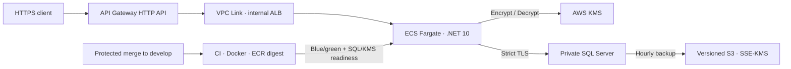

# ECS Cloud Resilience Laboratory

A working AWS infrastructure and delivery laboratory built with **Terraform/Terragrunt,
.NET 10 and ECS Fargate**. The API encrypts text with AWS KMS, stores ciphertext
in private SQL Server, and decrypts it on retrieval. Protected merges to `develop`
build and deploy the application through GitHub Actions and ECS blue/green.

**[Public DEMO](https://d20ioz705caon7.cloudfront.net/)** ·
**[Architecture Explorer](https://d20ioz705caon7.cloudfront.net/architecture)** ·
**[Technical documentation](docs/README.md)**

The public DEMO uses synthetic data and runs independently of the AWS laboratory.
DEV has real deployment and recovery evidence. PROD is not installed or validated.

## Architecture



- **Private runtime:** two Availability Zones, public NAT subnets and private
  application/data subnets; security groups restrict service-to-service access.
- **Automatic DEV delivery:** CI for the integrated SHA, one image build,
  immutable ECR digest, inactive ECS color, per-task readiness, ALB promotion,
  client health verification, drain and a versioned release record.
- **Separated authority:** Terraform owns infrastructure skeletons; delivery owns
  task revisions, service counts and ALB forwarding. OIDC, ECS task/execution roles,
  versioned Secrets Manager references and separate SQL runtime/migration users
  keep credentials and responsibilities distinct.
- **SQL identity:** the common Linux image receives environment-specific trust.
  DEV uses its definitive CA with certificate/hostname validation and no temporary
  trust bridge. SQL Express remains a single writer on EC2.
- **Recovery:** independent NAT ASG/E13 replacement per AZ, hourly SQL backups,
  protected recovery inputs and supervised cold restoration to a new instance.

Explore the [five current Archify diagrams](docs/interactive/CURRENT-INDEX.md)
for platform, delivery, network, SQL recovery and trust boundaries. The Explorer contains only these five final views.

## Demonstrated in AWS

| Result | Evidence and scope |
| --- | --- |
| Merge → GitHub Actions → ECR → ECS → observable HTTP change | [First successful automatic DEV delivery](https://github.com/Kendall04/terragrunt_demo/actions/runs/42751096835) |
| Strict SQL TLS using only the definitive DEV CA | [Automatic CA-only delivery](https://github.com/Kendall04/terragrunt_demo/actions/runs/42761946295/attempts/2) |
| SQL cold recovery: **SAME-AZ 24m42.6s**, **CROSS-AZ 41m31.5s** | [6 November trials](docs/RESULTS.md): source fencing, new EC2, restore, CHECKDB and API/KMS verification |
| NAT HTTPS connectivity restored in **2m29.191s** | [Dated NAT experiment](docs/RESULTS.md): ASG/E13 recovered connectivity; Sentinel supplied historical observation |
| Browser → API → SQL/KMS round trip | [Real UI validation](docs/RESULTS.md); separate from synthetic DEMO tests |

Measured recovery times are trial results, not SLAs. A final backup during a
planned cutover does not prove zero data loss during an abrupt disaster.

## Run locally

The static DEMO needs existing Node.js 20+ and no AWS credentials or package install:

```sh
node portfolio/product/server.mjs
# Open http://127.0.0.1:4182/
```

For API development, use the SDK in `global.json`, NuGet lock files and the
[application/data contract](terraform/docs/architecture.md#current-contract--application-and-data).
Starting the API requires real or explicitly isolated SQL/KMS configuration;
`/ready` checks those dependencies. See [validation and command effects](terraform/docs/validation.md)
before running integration or cloud-connected commands.

## Repository guide

| Area | Start here |
| --- | --- |
| Topology, services and ownership | [Architecture](terraform/docs/architecture.md) |
| CI, automatic DEV delivery and rollback | [CI](docs/CI-CD-REVIEW.md) · [Delivery](docs/DEV-DELIVERY-DESIGN.md) |
| IAM, secrets and strict SQL TLS | [Security](terraform/docs/secrets-strategy.md) · [SQL trust](demo-api/deploy/sql-trust/README.md) |
| Backups, retention and cold recovery | [SQL runbook](operations/sql-backup/README.md) |
| Infrastructure operation | [Native DEV lifecycle](terraform/docs/native-dev-lifecycle.md) |
| DEMO, static hosting and publication rollback | [Frontend](portfolio/product/README.md) · [Hosting](portfolio/product/HOSTING.md) |
| Experiments and retained contracts | [Evidence and history](docs/RESULTS.md) |

## Limits

The public DEV API has no user authentication and returns decrypted text: use only
synthetic, nonsensitive data. HTTPS terminates at API Gateway; internal application
hops use private HTTP. SQL uses strict TLS, but has no database HA or PITR.
Image rollback does not reverse database migrations. PROD promotion logic exists
in source; installation, authorization and an actual PROD deployment remain unproven.

Reliability Sentinel was separated and its AWS runtime retired on **10 November
2026**. [Code and historical evidence](terraform/docs/portfolio-operations.md#separated-sentinel-resources) remain
recoverable; retained archival storage is not active monitoring. NAT E13 and the
native SQL backup timer operate independently.
