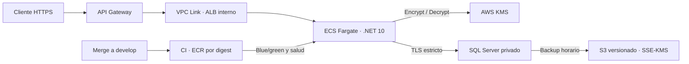

# Terragrunt Demo · ECS Cloud Resilience Laboratory

Una plataforma AWS privada con despliegue automatizado y recuperación comprobada.
Una API **.NET 10 sobre ECS Fargate** cifra texto con KMS, lo persiste en SQL Server
y lo descifra al consultarlo. Terraform/Terragrunt define la infraestructura;
GitHub Actions entrega la aplicación mediante OIDC y blue/green.

**[Explorar la DEMO pública](https://d20ioz705caon7.cloudfront.net/)** ·
**[Arquitectura actual](docs/interactive/CURRENT-INDEX.md)** ·
**[Documentación técnica](docs/README.md)**

La DEMO utiliza datos sintéticos y funciona sin el runtime AWS. El laboratorio
DEV sí ejecutó operaciones reales; PROD no está instalado ni demostrado.



## Qué demuestra

- **Infraestructura por capas:** VPC segmentada, subnets públicas/privadas en dos
  AZ, ALB interno, security groups y ownership explícito de Terraform y delivery.
- **Entrega DEV real:** merge protegido → CI del SHA integrado → build → ECR →
  color inactivo de ECS → readiness SQL/KMS → ALB → release versionado en S3.
  [Primer despliegue automático](https://github.com/Kendall04/terragrunt_demo/actions/runs/42751096835).
- **Datos protegidos:** roles task/execution separados, credenciales runtime y
  migrador distintas, Secrets Manager versionado y TLS estricto con la CA DEV
  definitiva. La imagen común recibe confianza por ambiente, sin puente temporal.
  [Entrega CA-only](https://github.com/Kendall04/terragrunt_demo/actions/runs/42761946295/attempts/2).
- **Recuperación NAT independiente:** dos NAT Instances administradas por ASG;
  E13 reconcilia EIP, ruta y source/destination checking. Un ensayo recuperó
  conectividad HTTPS en **2m29,191s**.
- **Backups y recuperación SQL:** productor nativo horario, manifiestos y copias
  S3 cifradas/versionadas. Recuperación fría **SAME-AZ: 24m42,6s** y
  **CROSS-AZ: 41m31,5s**, con aislamiento, nueva EC2, restore, CHECKDB y API/KMS.
  [Evidencia y límites](docs/V2-RECOVERY-SECURITY-20261105.md).

Los tiempos son resultados de ensayos fechados, no SLAs. SQL Express mantiene
un único escritor; no hay HA de base, PITR ni garantía de RPO cero. El backup
final de una recuperación planificada no acredita ausencia de pérdida abrupta.

## Ejecutar y explorar

```sh
# DEMO local: Node 20+, sin AWS ni instalación de paquetes
node portfolio/product/server.mjs
# API local: .NET SDK fijado en global.json; requiere configuración SQL/KMS
dotnet restore demo-api/terragrunt-demo.sln --locked-mode
dotnet run --project demo-api/terragrunt-demo
```

Abre `http://127.0.0.1:4182/`. [Modos, pruebas y paquete estático](portfolio/product/README.md)
describe DEMO y AWS Edition local supervisada. No publiques un proxy ni
credenciales: la API DEV pública todavía carece de autenticación y devuelve
texto descifrado. Utiliza únicamente contenido sintético no sensible.

## Mapa del repositorio

| Área | Punto de entrada |
| --- | --- |
| API, KMS, TLS y migraciones | [API](demo-api/terragrunt-demo/Program.cs) · [confianza SQL](demo-api/deploy/sql-trust/README.md) |
| Infraestructura y límites | [Arquitectura](terraform/docs/architecture.md) · [seguridad](terraform/docs/secrets-strategy.md) |
| CI/CD DEV y rollback | [Delivery simplificado](docs/DEV-DELIVERY-DESIGN.md) |
| Backups, retención y recuperación | [Runbook SQL](operations/sql-backup/README.md) · [recuperación nativa](operations/sql-backup/recovery/NATIVE-RECOVERY.md) |
| Diagramas editables y procedencia | [Atlas actual Archify 3.1.0](docs/interactive/CURRENT-INDEX.md) |
| Frontend y hosting independiente | [Product Demo](portfolio/product/README.md) · [CloudFront/rollback](portfolio/product/HOSTING.md) |
| Operación y retirada del runtime | [Ciclo nativo DEV](terraform/docs/native-dev-lifecycle.md) |

## Validación y alcance

`CI Validation` y `CD Safety Validation` son obligatorios para integrar cambios.
CI verifica aplicación, imagen, infraestructura, recuperación, contratos de
delivery, higiene y aceptación del repositorio. Los cambios documentales no
publican una imagen ni mueven tráfico. Terraform conserva su ciclo separado.
[Validación y efectos de los comandos](terraform/docs/validation.md) distingue
pruebas offline de ejecuciones AWS; no ejecutes operaciones por copiar un runbook.

Reliability Sentinel continúa como proyecto independiente. Su integración ya no
es una dependencia operativa de ECS. [Código recuperable e historia](docs/history/SENTINEL-SEPARATION.md)
y [recursos AWS pendientes de retiro autorizado](docs/SENTINEL-RETIREMENT.md)
conservan la evidencia sin atribuir monitorización autónoma al laboratorio final.
Los doce diagramas anteriores permanecen como snapshots históricos, con sus
fuentes, hashes y licencia Archify originales.
