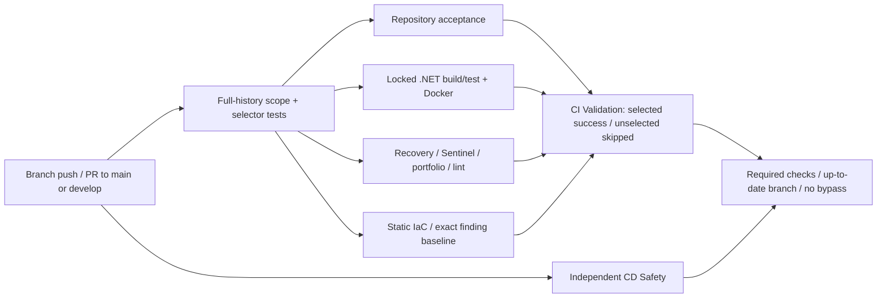

# CI/CD engineering review

Reviewed source: `dc3edcd64225a044d8a47b197ae585181cd0d385`.
GitHub settings/history refreshed on **7 November 2026, 06:00–06:14 UTC**.
The required-check rule below is installed. Workflow/selector optimization and the
[DEV delivery design](DEV-DELIVERY-DESIGN.md) remain proposals; no workflow,
environment, AWS IAM trust or deployment control was changed.

## Conclusion

CI executes useful, enforced tests within the orchestrator. Its scope selector
fails conservatively and the final validation job requires selected jobs to have
actually succeeded. GitHub now **requires `CI Validation` and `CD Safety Validation`
for main and develop**, from GitHub Actions, with up-to-date branches and no bypass
actors. The earlier merge-control gap is closed. Zero approving reviews remains
appropriate for the single-maintainer workflow; this does not waive CI.

Automatic CD is disabled. The current main versions of the public release,
deployment, rollback and plan wrappers fail closed or skip on incompatible refs.
V1 has genuine historical release/deploy/rollback runs; V2 was delivered by
supervised native administration. No working main/develop-based automatic V2 CD
is established by the current YAML or its lint results.

## Effective CI graph



## Installed merge gate

Ruleset [12173787](https://github.com/Kendall04/terragrunt_demo/rules/12173787),
`Main/Develop Ruleset`, remains active on exactly `refs/heads/main` and
`refs/heads/develop`. The only installed delta is:

```json
{
  "type": "required_status_checks",
  "parameters": {
    "required_status_checks": [
      {"context": "CI Validation", "integration_id": 15368},
      {"context": "CD Safety Validation", "integration_id": 15368}
    ],
    "strict_required_status_checks_policy": true,
    "do_not_enforce_on_create": false
  }
}
```

App ID 15368 is the actual `github-actions` producer read from successful main
checks, not an assumed integration. Full ruleset and effective branch-rule readbacks
match. PR/review settings, Copilot, deletion/non-fast-forward rules and empty bypass
list are unchanged; the authenticated maintainer reports `current_user_can_bypass=never`.
Exact update payload SHA256:
`283ea3e3ecbb5ad7b9c13a5e9cb9ff6e19a75cbd4100a1f4e8818ee91586ee38`.

[PR #39](https://github.com/Kendall04/terragrunt_demo/pull/39) exercised the real
rule with a deliberately missing Markdown target on head `f0f8289144188ba2f744640afefef0499af9e8c0`:

| Case | Actual result |
| --- | --- |
| CI pending | PR `mergeStateStatus=BLOCKED`, with no merge conflict. |
| CI cancelled | Run 42345179748 attempt 1 cancelled; the always-running aggregator failed because selected jobs were cancelled. Ordinary merge API returned **405**, explicitly naming failing `CI Validation`. |
| CI failed | Attempt 2 failed the existing knowledge/link check; hygiene passed, unselected App/infra correctly skipped. Aggregator failed and ordinary merge API again returned **405**. |
| Corrected documentation | Probe removed; normal CI and merge under this same ruleset are the positive integration test recorded in the PR. No bypass or synthetic status was used. |

GitHub accepts `success`, `neutral` and `skipped` check conclusions; therefore
require the two unconditional **aggregate** checks, not individually conditional
jobs. The CI aggregate uses `always()` and enforces actual results; Safety has an
unconditional job and `always()` result enforcement. Failure/cancellation is not
converted into an exemption. Workflow-level skips leave a required result pending.
Both workflows handle PRs to main/develop and their postmerge pushes; branch-push
CI does not replace the PR's merge-diff validation. Merge queue is not enabled, so
`merge_group` is not currently required. See [GitHub's check semantics](https://docs.github.com/en/pull-requests/how-tos/merge-and-close-pull-requests/troubleshooting-required-status-checks)
and [ruleset settings](https://docs.github.com/en/rest/repos/rules).

This is a merge gate, not immutable workflow enforcement: a maintainer-authorized
future workflow change still needs review. Binding the producer prevents an unrelated
status publisher from satisfying the check; it does not authenticate arbitrary future
job code by name alone. No extra reviewer or organization control plane was introduced.

[ci.yml](../.github/workflows/ci.yml) runs on branch pushes and PR lifecycle events,
including edited/ready-for-review. Its concurrency cancels superseded CI runs;
deployment wrappers instead use non-cancelling concurrency. CI uses read-only
GitHub contents access and no AWS OIDC. PR infrastructure diagnostics are a static
summary, **not a remote plan**.

### Selection and result correctness

[select-checks.py](../.github/scripts/ci/select-checks.py) verifies checkout SHA,
complete history, event commits and PR merge parents. It combines PR branch and
merge diffs; renames are deletion+addition. Empty, shallow, malformed, unknown-path
or ambiguous history selects every gate. A checkout identity mismatch fails outright.
The final job requires `success` for selected gates and `skipped` for unselected
ones; failed detection, cancelled/skipped required work cannot become PASS.

Important routing:

| Changed source | Selection / consequence |
| --- | --- |
| `.github/scripts/ci/`, composite actions, unmapped paths | All gates |
| `docs/`, `portfolio/`, `operations/integrations/` | Currently unmapped → all gates; safe but expensive |
| `demo-api/` | App; deploy/Docker source also acceptance+hygiene |
| `operations/sql-backup/` | App+acceptance+hygiene; Terraform extensions also infra |
| `terraform/` excluding docs | Infra+acceptance+hygiene |
| `terraform/docs/`, root README/AGENTS | Acceptance+hygiene, except three historical filenames and PNGs → hygiene |
| Shell readiness scripts and qualifying shell tests | App+acceptance+hygiene |
| `LICENSE` alone | No test gate; detection/result enforcement still execute |

The three legacy documentation-path exemptions remain in the selector after
documentation consolidation. They classify changed paths; they do not read or
require the removed documents. Removing those classifier entries would be a
separate CI change. No exemption was expanded here.

The selector is well tested, but it is still a hand-maintained dependency map.
A future newly named Python helper under `scripts/` defaults to acceptance+hygiene,
not App CI; transitive dependencies on the application must be reviewed explicitly.
The conservative unmapped fallback prevents silence but does not prove complete
semantic coverage. Keep mutation/negative tests and compare any replacement
selector against the current one before granting narrower exemptions.

### What the jobs really validate

- **Application:** SDK 10.0.402, locked restore of all four solution projects,
  Release build/tests, offline SQL host/readiness contracts, standard Docker recipe
  and packaged readiness-probe capability. Tests use doubles; native Express is
  an explicitly skipped integration test without its configured host. The SQL-Lab
  recipe and live TLS handshake are separately qualified evidence, not that standard
  Docker job. No automated live AWS end-to-end test or coverage percentage gate.
- **Hygiene:** pinned Actionlint/ShellCheck, shell syntax, recovery/portable suites
  with zero tolerated skips, release/task contracts, reproducibility tests and
  Terraform/Terragrunt formatting. `portfolio/test-contract.mjs` imports the V2
  product tests. Browser screenshots, public HTTPS QA and real AWS UI trials remain
  separately recorded; Node contracts do not replace Playwright.
- **Infra:** pinned TFLint 0.64.0/tfsec 1.28.14 and exact finding identity,
  multiplicity and source-snippet comparison; fmt/HCL checks. No remote init, plan
  or AWS credentials. Provider-free acceptance and isolated mocks are not a
  provider-connected validate of every deployable root. Portable module mock tests
  have separate local evidence and are not invoked by `ci-terragrunt.yml`.
- **Acceptance:** authority inventory, immutable specs, generated source/catalogs,
  closed request contracts, recovery/lifecycle invariants, provider-free Terraform
  expression tests and documentation links. Extensive control-plane regression is
  useful for retained code, but is the critical-path cost even for many doc changes.
- **CD Safety:** independent selector, mutation and shell tests. Its check identity
  should remain stable until branch rules and callers are migrated deliberately.
- **Secrets/dependencies:** GitGuardian is an external check, not a 28th YAML.
  Locked restore uses NuGet's feed audit behavior; CI does not set a comprehensive
  vulnerability-severity enforcement policy or scan every installed auxiliary image.
  ECR scan-on-push and previous explicit NuGet audit are separate evidence.

On [main run 42335233617](https://github.com/Kendall04/terragrunt_demo/actions/runs/42335233617),
all four selected gates ran: acceptance **8m47s**, App **5m00s**, hygiene **5m00s**,
infra **21s**. Detection took 9s; final validation 7s. Wall time was about **9m07s**,
not the sum of parallel jobs. Logs show **186 API tests passed**, **62 SqlBackup
passed / one native test skipped**, and **323 offline recovery/portable tests in
28 suites, zero skips**. Static findings were 24/46, unchanged. PR-only diagnostics
were correctly skipped on push. Counts describe this source/run, not universal coverage.

An open PR also receives both a branch-push run and a pull-request run for the
same head. Their concurrency groups differ (branch ref versus PR number), so
neither cancels the other. PR #38 reproduced this duplication. The event diffs
are not identical, so removing one trigger needs a deliberate coverage decision;
prefer PR validation plus main/develop postmerge validation, with an explicit
policy for branches that do not yet have a PR. This can save more work than
micro-optimizing individual tests.

NuGet cache keys include project files, locks and SDK; the broad restore key is
followed by locked restore. Docker caches layers; builds still use pinned recipes.
Tool downloads verify checked-in hashes. Hosted runner versions and some platform
tools remain externally maintained. Most static/acceptance reports live in runner
temporary storage and logs; no durable uploaded report is guaranteed by these YAMLs.
Saving compact test/finding reports would improve diagnosability without rerunning
failed work. Do not treat cache hits as skipped security validation.

### Measured optimization priorities

Six recent successful runs were inspected job-by-job. PR #38's exact source
`23afbe61587651359962e92df2d12c1ae1d8bf69` ran twice:

| Run | Event | Elapsed run envelope | Sum of job execution time |
| --- | --- | ---: | ---: |
| [42342216307](https://github.com/Kendall04/terragrunt_demo/actions/runs/42342216307) | Feature push | 8m45s | 18m45s |
| [42342221990](https://github.com/Kendall04/terragrunt_demo/actions/runs/42342221990) | PR | 7m46s | 17m33s |
| [42342860251](https://github.com/Kendall04/terragrunt_demo/actions/runs/42342860251) | Main postmerge | 7m18s | 17m26s |

The duplicate premerge pair consumes **36m18s of summed job time**. Retaining the
PR and removing that feature-push run would save 18m45s for this sample (~52% of
the pair), not 52% of all CI or wall time. Public runner billing was not queried;
these are execution measurements, not dollar charges. Skipped jobs contribute zero
(GitHub returned a -1-second timestamp artifact on one skipped diagnostic job).

On the PR run, Terraform install took 1s, infra tools 3s and hygiene tools 2s;
repeated fmt checks took 0–1s. Acceptance took 7m01s. Combining jobs or maintaining
a new tool image to save seconds is lower value than deduplicating event execution.
NuGet cache lookup took 3s, .NET setup 7s and Docker cache lookup 6s; locked restore
and actual build/test still ran. Preserve diagnostic artifacts on failure without
uploading state, connection strings or unredacted native evidence.

The current selector was executed locally on these representative paths:

| Change | Current gates | Conservative next proposal, not installed |
| --- | --- | --- |
| Root README | Acceptance + hygiene | Keep; authority/link consumers make “all Markdown exempt” unsafe. |
| `docs/CI-CD-REVIEW.md` | All four | Acceptance + hygiene after proving all document consumers; protect specs/manifests separately. |
| Product JS | All four | Hygiene/portfolio + provenance, with packaging and document/authority consumers explicitly mapped. Do not drop browser evidence requirements. |
| API `Program.cs` | App | Keep App; release still requalifies the exact artifact. |
| Native Terraform | Acceptance + hygiene + infra | Keep. No remote plan implied. |
| Portable NAT observer | All four | Keep initially: Python, generated module and CLR/package fixtures cross boundaries. |
| CI workflow/selector/shared action | All four | Keep all; ambiguity, rename/type changes and unknown paths remain conservative. |

Do not implement narrower selection from this table alone. Before removal of any
gate, map its actual imports/file reads/generated pins, compare decisions over
historical PR diffs, and add negative tests for missing/renamed dependencies, empty
history, base changes and cancellations. Trial the proposed selector in reporting
mode beside the current one. A deliberate reduction must have evidence that the
removed job has no affected consumer; matching today's positive examples is insufficient.

First optimization should be PR CI plus main/develop postmerge CI, with a documented
choice for branches without a PR. Do not cancel deployments to deduplicate CI, and
do not introduce path-level workflow filters that leave required checks pending.

## Inventory: all 27 workflows

`active` below means registered/enabled in GitHub, **not operationally admitted**.
Reusable workflows normally have no independent runs: their execution appears in
caller jobs. Run totals are a bounded API observation, not proof of current behavior.

| File under `.github/workflows/` | GitHub state | Effective source / historical evidence |
| --- | --- | --- |
| `ci.yml` | active | Push/PR orchestrator; 222 runs at readback |
| `ci-dotnet.yml` | active | Reusable App CI; eight old standalone runs also retained |
| `ci-repo-hygiene.yml` | active | Reusable hygiene, recovery and portfolio checks |
| `ci-terragrunt.yml` | active | Reusable static checks; eight old standalone runs retained |
| `ci-cd-safety.yml` | active | Independent push/PR safety check; 111 runs |
| `cd.yml` | **disabled_manually** | Push orchestrator; 11 historical runs; mutation jobs now inactive |
| `cd-scope.yml` | active | Reusable read-only scope classifier, no deployment |
| `cd-terragrunt.yml` | **disabled_manually** | Ordinary/high-risk wrappers fail closed; one old develop run |
| `cd-demo-api.yml` | active | Dispatch/call wrapper; infra/release/deploy fail closed |
| `cd-rollback.yml` | active | Dispatch/call emergency paths fail closed |
| `ci-terragrunt-manual.yml` | active | Dispatches plan wrapper; no independent successful plan |
| `ci-terragrunt-plan.yml` | active | DEV/PROD plan jobs fail closed on supported branch |
| `release-build.yml` | active | Main source fail-closed, historical-branch guard; eight old runs |
| `deploy-dev.yml` | active | Main source fail-closed, historical-branch guard; seven old runs |
| `rollback-manifest.yml` | active | Main source fail-closed; one historical DEV rollback |
| `promote-prod.yml` | active | Main/manual condition, fail-closed body; no PROD success |
| `e1-release.yml` | active | Reusable protected request; exact historical branch/pin/environment |
| `e1-dev-deploy.yml` | active | Reusable protected request; exact historical branch/pin/environment |
| `e1-dev-emergency.yml` | active | Reusable request; inactive without installation/governance |
| `e1-prod-promote.yml` | active | Same protected pattern; no admitted PROD installation |
| `e1-prod-emergency.yml` | active | Same protected pattern; no admitted PROD installation |
| `e1-infra-dev.yml` | active | Reusable ordinary DEV request; not an active Terraform pipeline |
| `e1-infra-prod.yml` | active | Reusable ordinary PROD request; inactive admission |
| `e1-infra-high-risk-dev.yml` | active | Reusable high-risk DEV request; inactive admission |
| `e1-infra-high-risk-prod.yml` | active | Reusable high-risk PROD request; inactive admission |
| `e1-plan-dev.yml` | active | Protected plan request; no current admitted caller |
| `e1-plan-prod.yml` | active | Protected plan request; no current admitted caller |

The last real V1 [release](https://github.com/Kendall04/terragrunt_demo/actions/runs/38825575655),
[deploy](https://github.com/Kendall04/terragrunt_demo/actions/runs/38825984998) and
[rollback](https://github.com/Kendall04/terragrunt_demo/actions/runs/38827037528)
used `codex/final-github-actions-cicd` and older immutable workflow source. Historical
success does not execute today's fail-closed main body. A workflow with a false job
condition can finish without deployment; inspect job outcomes and actual AWS receipts.

## Identity, governance and deployment ownership

GitHub OIDC subject customization includes `repo`, `context`, `job_workflow_ref`.
The two existing protected environments select only
`codex/final-github-actions-cicd`; neither has a required-reviewer rule. DEV/PROD
environments alone provide no reviewer/branch restriction. Separate older
bootstrap/infra approval environments do have reviewer rules. These facts are
not an authorization to widen a trust policy or dispatch a request.

IAM request roles were read alongside their actual policies/trust. Exact
environment/workflow subjects and numeric gateway targets constrain those roles;
service execution roles own ECR/ECS mutations. The current release gateway has
reserved concurrency zero. A source approval, IAM trust, environment restriction,
installed bundle, eligibility and usable gateway must all agree; merely editing
the branch name cannot reconnect CD. See [deployment contracts](../terraform/docs/deployment.md).

The current CodeBuild readback still selects controller `2643aa2efb14…`, image
worker `1d160fc37aa0…` and .NET/probe workers `6654dbff3bb6…`. Publishing newer
administrative runtimes did not install them into these project configurations.
Those installed identities must be reconciled before admitting a new release;
local SDK10 qualification is not evidence of the installed worker's toolchain.

E2 ownership uses protected state outside individual Terraform locks. Normal
delivery owns task revisions, desired counts and ALB forwarding; Terraform owns
the skeleton. Protected rollback selects qualified history and readiness, not
an arbitrary image tag. Native V2 administration must also exclude competing
controllers/humans. Image rollback never rolls back SQL schema or restores data.
The static CloudFront publisher has a separate stack and release manifest; it
does not use the ECS delivery route or EKS resources.

Security observations: routine CI has no AWS credentials; Actions are largely
SHA-pinned. `dorny/paths-filter@v4` remains mutable in the retained CD scope contract
and is explicitly deferred in the toolchain manifest. The legacy protected-workflow
pins and governance receipts must not be silently rewritten to remove this debt.
Ruleset HTTP 404 from the classic branch-protection endpoint does not mean main
is unprotected: the effective ruleset was separately read. The missing required
checks identified in PR #38 were installed and behaviorally verified above.

## Recommended target — proposal only

Keep **one CI entry**, reusable App/infra/hygiene jobs, and one stable final required
check. Preserve CD Safety's tests, initially retaining its separate check until
required-check migration is complete. Introduce explicit frontend/docs/portable
selection only after differential/mutation tests prove no under-selection.
Deduplicate repeated fmt checks/tool installation; do not remove trust-boundary
requalification from a real release merely because PR tests already ran.

The [DEV delivery design](DEV-DELIVERY-DESIGN.md) specifies one manual release,
separate rollback, jobs, OIDC/resource authority, readiness, partial-failure behavior
and migration. It explicitly distinguishes reusable validators from retired executable
wrappers. No new controller, CD activation or AWS permission is installed.

Recommended order for a later reviewed change:

1. **Done:** required CI final result and CD Safety, strict main/develop, no bypass;
   failing/cancelled PR rejection verified. Preserve this contract during migration.
2. Narrow CI selection with dependency tests, retain unknown-path fallback, publish
   concise test reports, and measure before/after duration on representative diffs.
3. Choose the single V2 DEV delivery route; reconcile exact source/environment/OIDC
   and AWS permissions before enabling it. Trial distinct-digest deploy/readiness/
   rollback with synthetic data and a separately authorized window.
4. Remove redundant dispatch wrappers and revoke unused identity paths together.
   Preserve historical run links and no-op/inhibited safety until replacement works.

Migration risks are accidentally granting main/PROD authority, losing conflict
exclusion or per-task readiness, treating a skipped job as success, and breaking
generated workflow/authority hashes. Those require a deliberate implementation
review. **No CI optimization or proposed CD executor was installed by this audit.**
