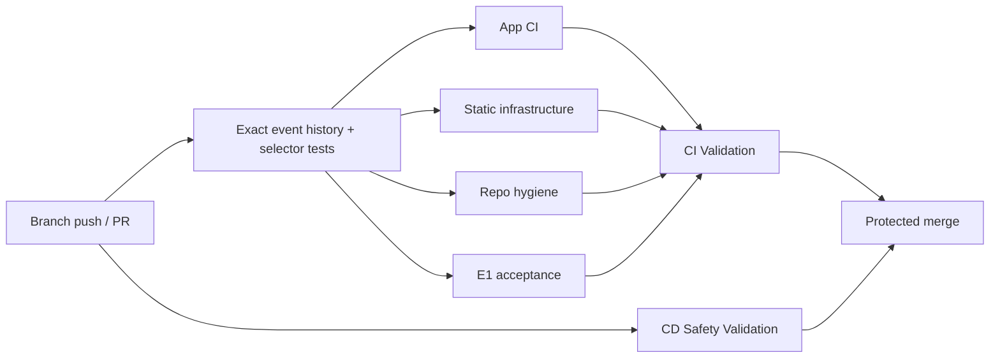

# CI and repository governance

[Automatic DEV delivery](DEV-DELIVERY-DESIGN.md) is the operational CD reference.
This page describes CI from the checked-in workflows and the 18 November 2026
GitHub readback. It supersedes the 7 November proposal/status narrative without
changing workflows, tests, IAM or branch rules.

## Required merge checks

The [Main/Develop Ruleset](https://github.com/Kendall04/terragrunt_demo/rules/12173787)
requires a PR, an up-to-date branch and these GitHub Actions checks (app ID 15368):

- `CI Validation`
- `CD Safety Validation`

There are no bypass actors or required human approvals. Push counterparts are
`CI Push Validation` and `CD Safety Push Validation`; they cannot satisfy a PR's
required contexts. The unconditional aggregators reject failed, cancelled or
missing selected jobs. A legitimately unselected job must be skipped.

## Selection and execution

[ci.yml](../.github/workflows/ci.yml) uses
[select-checks.py](../.github/scripts/ci/select-checks.py) over the complete Git
event history and simulated merge changes. Missing/ambiguous history selects all
gates. Changes to shared controls select conservatively; documentation can still
run hygiene and acceptance. That is validation, not an application deployment.

| Gate | Actual responsibility |
| --- | --- |
| [App CI](../.github/workflows/ci-dotnet.yml) | Locked .NET restore/build/test, container and readiness contracts. |
| [Repo Hygiene](../.github/workflows/ci-repo-hygiene.yml) | Portfolio/Archify, SQL recovery/storage, local observer helpers, reproducibility, delivery tests, Actionlint, ShellCheck and formatting. No Sentinel runtime build. |
| [Static infrastructure](../.github/workflows/ci-terragrunt.yml) | Terraform/Terragrunt checks and reviewed scanner baselines, without deployment credentials. |
| [E1 acceptance](../scripts/tests/final_acceptance/gate.py) | Closed authority/source contracts, immutable retired fixtures and documentation links. These retained models do not activate their historical controllers. |
| [CD Safety](../.github/workflows/ci-cd-safety.yml) | Independently selected shell/request/permission safety regressions and unconditional result aggregation. |

PR and branch-push CI can both execute. Readiness fixtures also appear in App CI
and Hygiene. These known redundancies were not optimized during documentation
cleanup; reducing them requires a separately reviewed selector/coverage change.
Diagnostics and test artifacts are not evidence of an AWS deployment.

## Delivery and historical workflows

`api-delivery.yml` calls the common `api-execute.yml` for DEV/PROD and explicit
recovery operations. `api-promotion.yml` calls trusted `api-evaluate.yml`, whose
PR evaluation has no AWS/OIDC deployment authority. The application identity in
[model.py](../scripts/api_delivery/model.py) excludes Markdown; a documentation-only
merge exits the scope job before delivery credentials or image publication.

Readback: `API_DEV_DELIVERY_ENABLED=true`, `API_PROD_DELIVERY_ENABLED=false`.
Historical `cd.yml` and `cd-terragrunt.yml` are disabled in GitHub. Other registered
legacy reusable/gateway workflows retain their source/authority constraints;
registration or `state=active` alone is not a functional deployment route.
Do not re-enable them as a fallback.

Current branch rules still allow merge, squash and rebase. The implemented PROD
evaluator requires merge commits and a main-only promotion check. Those activation
prerequisites are **not installed** merely because its code is in main. PROD
remains disabled; its optional evaluator can reject that prerequisite while the
two installed required CI checks pass. Ordinary final-project documentation
integration does not certify PROD readiness.

## Evidence

- [PR #39](https://github.com/Kendall04/terragrunt_demo/pull/39) tested pending,
  failed and cancelled required checks against normal merge API calls; the failure
  cases were rejected. The full dated [governance audit](https://github.com/Kendall04/terragrunt_demo/blob/1a39c46cc02f262c04f438207647acc1282393a0/docs/CI-CD-REVIEW.md)
  remains in Git, including the push/PR context correction and historical timings.
- [First automatic DEV run](https://github.com/Kendall04/terragrunt_demo/actions/runs/42751096835)
  proves actual delivery. YAML existence and Actionlint do not.
- [Validation guide](../terraform/docs/validation.md) separates local commands,
  cloud reads and mutations. No CI redesign accompanies this consolidation.
