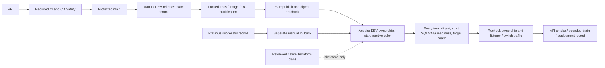

# DEV application delivery — proposed replacement

Status: **design for review; not installed or enabled**. Source reviewed:
`dc3edcd64225a044d8a47b197ae585181cd0d385`; AWS/GitHub readbacks: 7 November 2026.
The [CI review](CI-CD-REVIEW.md) describes the installed controls. Infrastructure
continues to use the [native lifecycle](../terraform/docs/native-dev-lifecycle.md).

## One route, two explicit operations

Use a manual DEV release from protected `main`, plus a separate manual rollback.
Do not trigger deployment on push, a PR, a successful CI run or a frontend publish.
PROD remains inhibited. A release identifies an exact main commit and a closed
recipe; rollback selects an existing successful deployment record, not a free-form tag.

Recommended workflow surface:

| Proposed file | Responsibility |
| --- | --- |
| `dev-release.yml` | Manual entry on main; bind source, recipe, cost/window and release ID; one non-cancelling DEV delivery concurrency group. |
| `dev-rollback.yml` | Manual entry on main; select recorded destination, confirm schema compatibility and reuse the same deployment executor/concurrency. No rebuild. |
| `dev-release-engine.yml` | Pinned reusable: admission, qualification without AWS credentials, then isolated publication with restricted OIDC. Return authentic manifest digest and qualification record. |
| `dev-deploy-engine.yml` | Pinned reusable: DEV ownership, candidate/readiness, promotion, readback, bounded drain and durable record. Shared by release and rollback. |

These are proposed names, not executable files. Avoid separate wrappers for each
color or layer. Keep CI's reusable jobs; application delivery never runs Terraform.
The static DEMO publisher and its CloudFront state remain independent.

## Jobs and admission

1. **Admit:** require manual dispatch on main, exact repository/account/region,
   main source SHA, required CI success for that SHA, approved recipe/certificate
   fingerprint, unexpired laboratory budget and no retirement in progress. A stale
   queued release is rejected when it starts. No caller-selected role, resource
   ARN, Dockerfile path, shell command, buildspec override or arbitrary artifact URL.
2. **Qualify without AWS:** use the existing sealed source closure (four .NET
   projects, root contracts); locked restore/build/test; retain the native-test skip
   explicitly. Build linux/amd64 from pinned bases; verify OCI manifest, non-root
   runtime and strict SQL trust. Standard remains standard; SQL-Lab is DEV-only.
   Never use an isolated container's missing SQL/KMS as fabricated readiness PASS.
3. **Publish:** a separate credential-bearing job downloads the exact same-run
   artifact, verifies its GitHub artifact digest and sealed contents, and publishes
   only to `demo-dev-shared-demo-ms`. Record the ECR manifest digest by AWS readback,
   source SHA, recipe/base/certificate hashes, toolchain and test results. Do not
   substitute a Docker ImageId or mutable tag. Failure after an uncertain push is
   reconciled by digest; it does not authorize a second publication or deployment.
4. **Deploy candidate:** verify cluster/services/listener/target groups, exact task
   roles, secret VersionId, approved image and available time. Acquire the existing
   application exclusion before mutation. Build a fresh inactive task definition;
   the installed green revision 9 is a placeholder, not a ready application.
   Migrations remain a separate operation, never HTTP startup or image rollback.
5. **Readiness and promotion:** start only the reviewed replica count. Verify every
   task's revision and image digest, stable running set, packaged readiness result
   against actual SQL/KMS, and ALB target health. Immediately recheck listener and
   ownership before switching. `/health/live` and one public `/ready` response alone
   cannot establish readiness of each candidate. Verify the public API after the
   switch using a bounded synthetic read/write only in an authorized live trial.
6. **Finish:** observe the old color draining, then reduce its count through the
   same delivery owner; record before/after IDs, times, outcomes and immutable
   qualification/secret references. Release ownership only after effects are known.
   Do not schedule the retired recurring scale-down helper as an incidental shortcut.

Manual dispatch is the owner's approval for the specified release. For a single
maintainer, do not require an impossible second-person review or self-review ban.
Use dedicated environments restricted to main, and deliberate permissions for each
job. A second promotion approval is optional only if another reviewer is available;
otherwise the approved bounded release includes promotion **after** readiness.

## IAM/OIDC migration is substantive

Today's request roles `e1-request-release` and `e1-request-deploy-dev` accept exact
environment/reusable-workflow subjects pinned to
`f0ba8ad1d6528d362693c8de932f935c8084529d`. Their environments admit only
`codex/final-github-actions-cicd`. Those roles submit protected requests; the
CodeBuild service roles perform mutations. Release/deploy gateways have concurrency
zero. The installed release/image/.NET runtimes are older than separately published
administrative images. None of these facts admits a new main-based direct executor.

Keep GitHub's `repo`, `context`, `job_workflow_ref` subject composition. New proposed
OIDC identities must bind the exact repository, dedicated environment, reusable
workflow **immutable commit**, and audience `sts.amazonaws.com`. Environment branch
restrictions and executor validation enforce main; an environment subject by itself
does not include the caller branch. Do not weaken all other subjects to accommodate
this migration. The reusable executor checks out its pinned trusted tooling; source
and artifacts are inputs, not executable replacement deployment scripts.

| Proposed authority | Minimum capability / excluded authority |
| --- | --- |
| Qualification job | GitHub contents/artifacts only; no AWS/OIDC, secrets or infrastructure mutation. |
| DEV publisher | ECR authentication (`GetAuthorizationToken` necessarily `*`), layer upload/PutImage/readback on the single DEV repo; exact qualification-record prefix. No ECS, IAM, KMS decrypt or secret values. |
| DEV deployer | Read bound runtime metadata; register the closed task-definition families; update only two DEV services and exact listener/candidate rule; pass only the four reviewed ECS task/execution roles to `ecs-tasks.amazonaws.com`; exact ownership/deployment-record prefixes. No EC2, Terraform state writes, IAM administration or secret-value reads. |
| ECS execution/task roles | Execution role resolves the versioned connection secret and pulls/logs; task role uses the application KMS key. Application SQL remains SELECT/INSERT plus EF-history SELECT. |
| Native infrastructure operator | Existing separate plan/apply authority. No adoption of application delivery ownership. |

Some APIs (notably task registration and ECR authentication) cannot be made
resource-exact in the same way as UpdateService. A future IAM proposal must enumerate
those exceptions and supported conditions, boundaries/resource policies, PassRole
composition and deny tests. Do not copy a broad CodeBuild service role into OIDC or
claim unsupported IAM conditions enforce an image digest. Trusted executor validation,
artifact binding and restricted role composition remain necessary.

GitHub concurrency does not exclude an administrator, Terraform or an old AWS
controller. Keep the existing E2 compare-and-swap exclusion and native preflight;
do not add a new lock service. Reusing that storage from a new principal requires
an explicit review of its resource policies and owner format. Never forge an old
controller receipt. If the current adapter cannot admit the new owner without a
larger controller rewrite, retain supervised native delivery until that small
ownership boundary is resolved; do not revive the entire historical control plane.

## Failure and rollback contract

| Failure point | Safe outcome |
| --- | --- |
| Before candidate mutation | Leave active tasks/listener unchanged; preserve failed qualification/publication evidence. |
| Candidate unhealthy / timeout | Do not switch. Reconcile its actual revision/tasks, then stop only that attempt's candidate; retain active service. |
| Listener write response uncertain | Read listener, both services and record/ownership before doing anything else. No blind second switch. |
| After promotion / before drain finishes | Keep prior digest and task configuration recoverable; record partial state. A separate rollback uses readiness and the same exclusion. |
| Runner cancelled/lost | Non-cancelling concurrency limits ordinary supersession, not machine failure. A lease expiry is not proof effects stopped. Operator readback/reconciliation is required before another writer. |
| Database incompatible | Stop deployment/rollback. No automatic schema downgrade or database restore. |

Do not describe this design as unattended recovery. Durable records and bounded
native reconciliation replace a new cleanup controller. A new executor must cover
network ambiguity, cancellation, duplicate request IDs and record-write failure.

## Reuse and migration

Keep `ecs-readiness-gate.sh`, the task-definition renderer/validator, strict .NET
database policy, OCI/source sealing and deployment-record schemas/tests. Review
their current inputs against V2 first. `ecs-blue-green-deploy.sh` deliberately
exits with `E1_LEGACY_PATH_RETIRED`; its internal functions are reference code,
not a command that can be enabled by changing a branch name. Its old recurring
drain schedule and mutable connection selection must not leak into the new route.

After owner review: implement the narrow executors offline; add rejection/partial
failure tests; approve exact IAM/environment changes and a separately budgeted DEV
trial. Validate two distinct digests, candidate SQL/KMS readiness, promotion and
explicit A→B→A rollback. Preserve V1 proofs, but require new V2 evidence.

Only after that trial, retire unused callers and their corresponding AWS trust
and request authority together. Initial retirement candidates are the public
`cd-demo-api`, `release-build`, `deploy-dev`, `rollback-manifest`, `promote-prod`
wrappers and unused e1 application callers. Inventory generator/hash dependencies
before removal. Infrastructure wrappers require their own decision; deleting YAML
does not revoke IAM. No such change occurs in this documentation PR.
