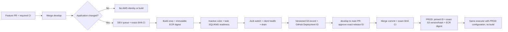

# Automatic API delivery: one executor, two environments

**DEV implemented and running. PROD disabled and unqualified.** First automatic
DEV delivery: [run 42751096835](https://github.com/Kendall04/terragrunt_demo/actions/runs/42751096835).
CA-only TLS delivery: [run 42761946295/2](https://github.com/Kendall04/terragrunt_demo/actions/runs/42761946295/attempts/2).
Terraform and CloudFront retain separate lifecycles. The original manual bootstrap
is not counted as an automatic deployment. The approved administrative handover
fenced legacy writers; historical E2 remains intact and is not delivery authority.
Sentinel is not a dependency of this executor.

## Design decision

The previous design coupled every deployment to E2 ownership, signed receipts,
historical attempts and publication recovery. Those mechanisms did not make the
first automatic deployment operable: interrupted E2 ownership has no supported
administrative release. We replace that dependency with a GitHub environment
queue, a small versioned operational record, and an explicit administrator
handover that prevents competing writers. We do **not** reset the existing E2.



| Keep | Replace or retire |
| --- | --- |
| Required CI/Safety, strict branch updates, no bypass | One separate activation flag per environment |
| Common blue/green algorithm and real SQL/KMS readiness | E2 mutation grants → GitHub queue plus fenced external writers |
| Exact digest, versioned secrets, `validated-v2`, two containers | Attestation/artifact discovery → GitHub Deployments metadata index |
| Immutable S3 configuration and release bytes | Historical attempt reconstruction → one explicit producer attempt |
| Previous compatible image and live recovery checks | Permanent ownership hold → observable state and explicit reconciliation |

The four [workflow files](../.github/workflows/api-delivery.yml) are two callers
and two reusable jobs, not four competing delivery paths. The
[executor](../scripts/api_delivery/executor.py) is shared by DEV, PROD and rollback.
[GitHub](../scripts/api_delivery/github.py) handles the index/check;
[AWS](../scripts/api_delivery/aws.py) handles ECS/ALB/ECR;
[state](../scripts/api_delivery/state.py) handles operational recovery.

## Normal operation and promotion

`API_DEV_DELIVERY_ENABLED` and `API_PROD_DELIVERY_ENABLED` default to disabled.
The old shared `API_DELIVERY_ENABLED` is ignored by this implementation. A
docs-only push exits before credentials or the environment queue. CI and CD
Safety must succeed on the exact integrated SHA before AWS credentials.

GitHub serializes each environment with `cancel-in-progress: false` and
`queue: max`. This is the documented [multi-pending queue](https://docs.github.com/en/actions/how-tos/write-workflows/choose-when-workflows-run/control-workflow-concurrency),
not the single-pending queue that can discard C when old B is retried. Queue
capacity is finite; rejected runs are visible failures. Once admitted, an old
application lineage is skipped before build. Documentation descendants preserve
eligibility; B → C → B′ does not revive the original B. A running deployment is
not cancelled midway when a newer merge arrives.

Successful delivery writes an immutable SSE-KMS S3 manifest (conditional create,
exact VersionId and SHA-256). The subsequent step creates a
[GitHub Deployment](https://docs.github.com/en/rest/deployments/deployments)
with task `api-release` and a
[success status](https://docs.github.com/en/rest/deployments/statuses).
The payload contains repository/environment, source/application identity, OCI
digest, ECS revision, health result, configuration reference, previous compatible
target, producer run/attempt and exact S3 reference. No secret values, SQL text,
credential material or private logs belong in this public metadata. Artifacts
are diagnostic downloads only; deleting them does not erase a release.

The evaluator runs trusted base code with contents/actions/PR/deployments read
and checks write. It has **no OIDC, AWS credentials or deployment environment**.
It discovers a healthy DEV release matching the PR's application content and
first-parent lineage. `API Promotion Validation.external_id` fixes the PR, base,
application, release ID and evaluator run/attempt; the exact check fixes the head.
The evaluator rereads both the check and release and rechecks the live PR before
success. Presentation URLs are not identity fields.

PROD reads the successful check completed before merge, requires two parents
exactly matching the approved base/head, and fetches that release ID. Its own role
checks the exact S3 version, bytes, encryption and ECR manifest digest before
mutation. If B was approved and C appears after merge, PROD still consumes B.
If C enters the PR before merge, the head/check must be revalidated. Keep strict
branch updates: merge main back into develop through a normal PR after promotion.

This installation expects an explicitly approved **shared ECR repository**;
PROD cannot publish to it. Cross-account registry copy is not implemented. SQL,
secrets, roles and environment configuration remain separate. Future independent
registries need a reviewed digest-preserving copy, not a rebuild.

Trust boundary: repository administrators and protected workflow editors can
change publisher/check logic. The reader checks GitHub Actions identity,
workflow, event, branch, producer SHA/attempt and successful execute step; it
does not claim cryptographic separation between mutually trusted repository
workflows. S3 version/hash and ECR checks independently protect the AWS consumer.
Deleted index entries or missing producer evidence block promotion and can be
republished only through a verified current-state reconciliation. No latest-image
fallback or AWS credentials in PR evaluation are needed.

## Failure, rollback and reconciliation

`api-delivery/<env>/state.json` is versioned SSE-KMS metadata with `HEALTHY`,
`DEPLOYING` or `RECONCILE`, current/previous release and candidate revision.
Conditional `If-Match` detects conflicting writes. This object is **not a lease**:
GitHub serialization and administrative exclusion of other writers are required.
The role cannot create missing state, overwrite operation evidence or write the
handover. Missing/denied state is never interpreted as an empty environment.

Before drain, the executor rereads both ALB routes, exact task cohort and the
client `/ready` response. SQL/KMS failure restores both routes while blue still
has its original capacity. After drain starts it preserves the new color rather
than switching to capacity that may already be gone. `stop` waits for ECS zero
and **empty target groups**, including ALB deregistration delay.

| Situation | Operator action and guarantee |
| --- | --- |
| Healthy S3 release, GitHub publication failed | Retry the original run or dispatch `reconcile`. Verify current revision, exact S3/configuration and current SQL/KMS; republish without build/ECR/ECS mutations. New releases wait for publication. |
| Failed operation, old color still serving | Inspect operation journal and both routes. If the candidate remains running, stop only that positively identified inactive candidate under supervised maintenance, then `reconcile`. It never guesses unknown effects away. |
| Candidate serves after drain, final record missing | `reconcile` accepts only its recorded revision/configuration, both settled routes, zero inactive capacity, exact healthy tasks and fresh client SQL/KMS. It writes a new reconciliation record preserving the original source; no redeploy. |
| Unknown routes, foreign revision or unsettled capacity | Keep activation off, repair the observed state through supervised operation, then rerun reconciliation. No force/reset command. |
| Rollback after completed deployment | Dispatch `rollback` for the environment. Resolve its previous compatible image automatically, validate the current baseline, deploy to inactive color using current approved configuration, then health/switch/drain. No DB rollback or automatic schema migration. |

Commands after installation (select the corresponding protected branch; no SHA
or image inputs):

```sh
gh workflow run api-delivery.yml --ref develop -f environment=dev -f operation=reconcile
gh workflow run api-delivery.yml --ref develop -f environment=dev -f operation=rollback
```

Reconciliation runs in the same environment queue. It changes evidence/state,
not ECS, ECR or ALB. Current source and producer must pass CI even for recovery.
Compatible revision/configuration metadata alone does not prove valid credentials
or certificates: live SQL/KMS readiness is still mandatory.

## Installation and the retained DEV E2

**Activation blocked:** the known E2 DEV/application generation 18 is `ACTIVE`,
operation `09342d65-e953-4865-b177-6e7bbbaad967`. Blue:16 was installed by supervised
bootstrap. [E2-R](../terraform/docs/e2r-owner-recovery.md) has no administrative
release; this change neither implements nor simulates one.

Before any replacement writer can act, an administrator must:

1. Identify the old bootstrap invocation, credential sessions and descendants;
   preserve exact E2 version/ETag, operation journal and execution evidence.
2. Disable historical entrypoints and establish effective denial of mutations by
   old application controllers/operators on these exact ECS services and ALB
   routes. Inspect role policies, resource dependencies and active executions;
   deny/revoke the old writer sessions and terminate their processes. A disabled
   workflow or elapsed deadline alone is insufficient. Fence Terraform applies
   and manual writers too; scheduled NAT/Sentinel work stays outside this scope.
3. Establish settlement of issued UpdateService effects from the recorded
   operation and fresh ECS/ALB readbacks. Verify exact blue:16 digest, cohort,
   probe exit zero, task ENI targets, both routes, no pending/draining old targets,
   green zero and client SQL/KMS. A matching snapshot alone cannot prove a paused
   old executor will not send later.
4. Preserve the retained E2 **unchanged** as historical evidence. Only after
   steps 1–3 are proven, publish an immutable `API_HANDOVER_V2` approval recording
   the administrator, effective writer controls, execution termination and
   settled-effect evidence. Pin its exact version/hash and binding hash in
   `API_HANDOVER_REF`. Pin the unchanged E2 version/ETag/hash as `legacy_head`;
   any later change stops delivery. This is retirement of old authority, not a
   fabricated terminal SUCCESS or an E2 unlock.
5. Archive/admit the real native baseline configuration and initialize
   `API_STATE_V2` with environment, `phase=HEALTHY`, `current=null`,
   `github_id=null`. The pinned binding supplies the native baseline. Do not
   label blue:15 compatible if its trust contract fails. A genuinely empty
   environment needs an empty readback and `native_baseline=null`.

No handover was published by this implementation. If exact termination/effect
evidence is unavailable, keep the existing runtime and E2 untouched; code can be
reviewed and merged while both activation flags remain absent/false.

Install the [scoped permission definitions](../scripts/api_delivery/permissions.py)
only after that handover is reviewed. The environment restricts DEV to develop
and PROD to main. Preserve the repository's custom OIDC `job_workflow_ref` subject
and environment claims. Variables: `API_ACCOUNT_ID`, `API_REGION`,
`API_DELIVERY_ROLE_ARN`, `API_BINDING_REF`, `API_HANDOVER_REF`. Keep DEV/PROD flags
independent. Verify effective IAM, CMK and bucket policies with the installed
resources; definitions/tests are not proof of effective AWS access. Store the
handover using the evidence CMK. PROD gets only version reads of DEV release
manifests and corresponding KMS decrypt, not DEV mutations or secret values.

PR #45 installs the superseded signed evaluator: leave it open and do not merge
it as the activation path. Install this evaluator and its dependencies in main
through a separate protected, application-neutral bootstrap PR. Then install
the **main-only** required promotion check and merge-only rule, preserving CI,
CD Safety, strict updates and no bypass. Administrator readback must confirm
repository merge commits are enabled; a read-only job need not see that setting.
Do not require a check before its producer exists on the default branch. DEV
activation and first real merge trial come after handover/role/baseline admission;
PROD activation waits for genuine PROD SQL/TLS, roles, ECR and ECS qualification.

## Validation boundary

```sh
python3 -I -B -m unittest discover -s scripts/tests/api_delivery -v
python3 -O -I -B -m unittest discover -s scripts/tests/api_delivery -v
```

Tests exercise real Git histories, GitHub REST readers, CLI/state transitions,
S3 version/hash checks and the common executor with deterministic transports.
They retain readiness, rollback, lost ALB acknowledgements, one-blue/two-green,
old/new secret configuration, metadata and IAM boundaries. Attestation/artifact
and E2-publication permutations were removed with those retired mechanisms;
independent E1/E2/security suites and immutable historical evidence remain.
These tests do not qualify GitHub's live deployment-index behavior, effective
OIDC/IAM, Fargate health or an automatic AWS deployment. The first activation
trial must record merge/run, GitHub deployment ID, S3 version/hash, ECR digest,
ECS revision/task digest, visible HTTP change and `/ready` 200.
