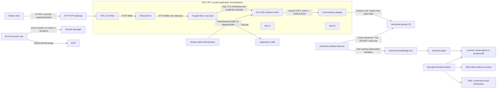

# ECS V2 DEV: data flows, trust boundaries and security review

Reviewed against the running DEV deployment on 5 November 2026, starting from
`a913a822492b633784eda15758d1feaf43a7c051`. This document describes implemented
controls and explicit gaps. It is not a production certification. Dated execution
evidence and recovery results belong in [the operational record](V2-RECOVERY-SECURITY-20261105.md).

## Implemented data path

There is no direct public SQL or Fargate address. Actual SG readback restricts
ALB port 8080 to the VPC Link SG, Fargate port 8080 to the ALB SG, and SQL port
1433 to the Fargate SG. NAT accepts VPC traffic for forwarding. Default SG
self-reference exists but is not an application permission grant.

Client TLS terminates at API Gateway. The VPC Link/ALB/application hops use HTTP
inside the SG-restricted VPC; they are **not** end-to-end encrypted. SQL uses
`Encrypt=True;TrustServerCertificate=False;HostNameInCertificate=sql.demo.internal`.
Its public certificate is pinned in the DEV image. The demo self-signed leaf is
an explicit trust anchor, not an enterprise CA or automatic certificate rotation.
Private key material is held in the approved encrypted transport secret and on
the SQL host with restrictive ownership/mode; it is excluded from Git, images,
user data, Terraform inputs/state and command text.

## Identities and authority

| Identity / boundary | Effective purpose | Important limit or residual risk |
| --- | --- | --- |
| `cnp-cert-admin` | Explicit administrative operations and sensitive configuration | Powerful human credential; single-operator trust, no separation-of-duties claim |
| `TerragruntDemoDevOperator` | Native DEV Terraform owners and approved temporary deltas | Authorization is the composition of installed Parts, boundary, resource policies and explicit Deny; a small additional policy alone is not the effective policy |
| ECS blue execution role | Image pull, logs, versioned runtime connection secret | This role is not the application task role; the secret is injected at task start |
| ECS blue task role | Application CMK operations | Compromise of the application can decrypt its authorized ciphertext; encryption does not replace application authorization |
| `demo-dev-data-sql-ec2-role` | Bootstrap secrets, SSM, backup package and own backup prefix | Host compromise can obtain bootstrap credentials; no claim that SQL runtime privileges constrain a compromised host administrator |
| SQL `recovery_app` | SELECT/INSERT on `DemoTexts`, SELECT on EF migration metadata | No UPDATE/DELETE/DDL, db_owner or ddladmin; login is enabled only after verified handoff |
| SQL `recovery_migrator` | Explicit reviewed migrations | Disabled after handoff; absent from HTTP startup and Fargate secret injection |
| Backup / verifier SQL identities | Backup plus isolated verification database | Separate from application runtime; private credential files are root-only, not Terraform values |
| External backup observer role | List one prefix, read exact versions, decrypt through S3, publish two observation types | No SQL secret, S3 delete/write, journal mutation or remediation privilege; time bounded |
| Sentinel ingest / worker / watchdog / cleanup roles | Existing bounded journal workflow, archive and notices | Boundaries, scoped resources and expiry retained; historical permanent failures remain visible |
| NAT recovery Lambdas | Existing E13 EIP, route and SDC repair | Published version 6 and membership checks retained; no SQL recovery authority |
| GitHub OIDC request identities | Closed protected requests when their installed contract is active | Disabled CD and historic workflow pins do not prove current automatic deployment readiness |

The SQL role's new backup grant uses only the new experiment prefix and exact
package object. Writes require `If-None-Match: *`, SSE-KMS and the correct CMK.
KMS use is restricted by caller account, regional S3 service and object encryption
context. Existing bucket statements, CMK statements and backup versions remain.
Versioning and create-only writes prevent accidental overwrite; they do not
constitute S3 Object Lock or protection against a fully authorized administrator.

## Ownership and deployment consistency

Terraform owns VPCs, subnets, security groups, SQL compute, ECS skeletons and
monitoring resources. Native DEV delivery owns task-definition revisions,
desired counts and ALB forwarding. Recovery must not let Terraform reset those
fields while delivery is operating. Native root locks protect each state, not
all application operations across roots.

The running API was deployed through the owner's native administrative path.
Its genuine ECR digest, task definition and live API checks are recorded. That
is **not** a WP3 qualification, an OIDC delivery trial, or proof that historical
controller approvals cover a new commit. CD remains disabled. WP3/WP4 contracts
and historical bindings are preserved; recipe-related generated hashes describe
source candidates and were not applied to the security root.

The reusable request workflow still restricts its source branch and immutable
workflow identity to the historical installation. Changing only the branch text
would not create matching AWS trust or source approval. The practical DEV path
therefore remains one supervised native operator. Its E2 readback plus disabled
gateways reduce conflicts, but are not an atomic lease against another human
administrator. A multi-operator deployment requires the existing lease mechanism
to be used, not another parallel deployment controller.

## Findings and disposition

| Risk | Evidence / disposition |
| --- | --- |
| Vulnerable deployed image | ECR reported 12 HIGH, 4 MEDIUM, 2 LOW and 3 UNDEFINED entries. Exact Ubuntu fixes were added to the DEV SQL-Lab recipe; the final digest has a completed ECR basic scan with zero findings. This is a dated scan, not proof against all future vulnerabilities. |
| Missing operational backups | Fixed: strict-TLS producer, persistent hourly timer, create-only S3/KMS backup and external exact-version verifier installed. Cold recovery remains a separate proof. |
| SQL root disk deleted during replacement | Fixed in DEV with explicit `recovery_preserve_root_volume`; real readback confirms `DeleteOnTermination=false`. Retained disks have continuing cost and require explicit deletion approval. |
| Public unauthenticated API | Real DEV limitation: all four routes have `AuthorizationType=NONE`; no stage throttle override. Anyone reaching the endpoint can use its allowed demo read/write path and incur KMS/API load. Do not expose real data or present this as production authorization. |
| Incomplete object-access audit | Real gap: no permanent CloudTrail trail/event data store was found; the five installed security buckets have no server-access logging. CloudTrail event history alone does not prove S3 data-event coverage. Sentinel's own archive is a separate evidence path. |
| Encryption warning versus CMK control | Security buckets actually use AES256 SSE-S3 and versioning. Missing-encryption/versioning findings arise from unresolved generated JSON relationships. Lack of a customer-managed key is a real difference in control/audit, retained as laboratory debt. Backups, secrets, application data and Sentinel archive use documented customer-managed keys. The SQL root disks use the AWS-managed `alias/aws/ebs` key; this is encrypted storage, not customer-managed key control. |
| Scanner coverage limits | The 24 TFLint warnings and 46 tfsec findings reproduce with exact identity, multiplicity and source hashes. Supplemental dynamic Terraform can evade semantic scanner evaluation; absence of a finding does not establish policy correctness. IAM scopes were reviewed separately. |
| Host / regional failure | One SQL writer, one active application task, one AWS region. Two NATs do not provide database HA. Region-wide recovery and cross-account backup survival are not demonstrated. |
| Backup freshness and invalid data | Observer checks newest committed manifest, exact versions, full bytes, checksum receipt and original backup time; it never substitutes an older good backup for a newer corrupt commit. It does not prove a restore or distinguish every failed local attempt from a stalled producer before the freshness threshold. |
| SQL transaction log growth | Current database uses FULL recovery and COPY_ONLY full backups. No log-backup/PITR chain is installed. Log truncation and long-running workload capacity remain a real limit; do not claim PITR or switch recovery model implicitly. |
| Sentinel historical failures | Four permanent failures remain unchanged. New observations advance checkpoints and archive once, but these results do not erase historical `STALLED` evidence or certify permanent unattended monitoring. |
| Container boundary | Image runs as UID 1654 with no SQL migrator secret; the current task does not enforce read-only root filesystem or an explicit capability-drop list. Application compromise remains within the task role/network boundary, not a proof of sandbox immunity. |

### Installed control-plane images: unresolved findings

Readback on 6 November matched twelve installed Lambda/CodeBuild consumers to
their exact ECR digests. Their existing completed scans are dated 15 October
(controllers/workers) and 30 October UTC (NAT), not fresh scans:

| Installed image family | Existing findings per image | Disposition |
| --- | --- | --- |
| Image worker `e1-payload-image` | 15 CRITICAL, 56 HIGH, 35 MEDIUM, 4 LOW | Requalify and patch before another WP3 build; the native API image's clean scan does not cover this worker. |
| Three NAT handlers | 19 HIGH, 24 MEDIUM, 9 LOW, 1 UNDEFINED | Active residual risk; patch their pinned base and qualify the three handlers before a longer-lived deployment. No NAT mutation in this recovery increment. |
| Six controller/gateway/delivery images | 12 HIGH, 20 MEDIUM, 5 LOW, 1 UNDEFINED | Installed historical images remain separate from newly published candidates. No claim that a newer candidate fixed the installed runtime. |
| .NET and probe workers | 8 HIGH, 2 MEDIUM, 2 LOW | Existing scans identify debt in the installed images; qualify replacements before use. |

Counts are scanner entries, not distinct CVEs or proof of reachable exploitation.
For example, NAT entries include Amazon Linux OpenSSL, curl, PCRE2, libcap and RPM;
the image worker includes Alpine curl/OpenSSL critical entries. Full findings,
package versions, scan dates and immutable image mappings are preserved privately
in `INSTALLED-CONTROL-IMAGE-FINDINGS.private.json`. No scanner was suppressed or
unassessed entry relabelled as a false positive. This means **the platform-wide
image-security review is not closed**, despite the application image fix.

The [complete 70-entry classification](V2-STATIC-FINDINGS-20261105.json) preserves
every scanner identity, source snippet hash and repeated occurrence. It does not
replace or relax the original exact-match baseline.

TFLint debt comprises seven child-module version declarations, two provider
constraints, fourteen unused declarations and one deprecated index expression.
Native owners pin Terraform/provider versions; unused declarations do not grant
permissions. Removing them solely to reduce a count would not repair the material
live issues above. The original scanner checker and baseline were not weakened.
No PROD resource was used as evidence of a verified DEV configuration.

Ubuntu primary references: [PCRE2](https://ubuntu.com/security/notices/USN-8974-1),
[APT](https://ubuntu.com/security/notices/USN-8996-1),
[zlib](https://ubuntu.com/security/notices/USN-8954-1),
[CA bundle](https://ubuntu.com/security/notices/USN-8944-1),
[XZ](https://ubuntu.com/security/notices/USN-8945-1).

## Recovery safety boundary

An unreachable host is not a fence. Recovery first drains application writers,
checks SQL sessions, disables runtime/migrator logins and makes the source
database read-only. A final verified backup may then improve planned-cutover RPO.
The original encrypted disk is retained. Before the destination accepts writes,
the administrator must verify that the exact original EC2 identity is terminated.
If that cannot be established, activation stops.

The new host is provisioned through the existing Data owner in the selected
private subnet. It receives the existing TLS material confidentially, restores
an exact backup version into a new database, runs CHECKDB, compares data identity
and migration history, remaps authorized logins and performs the reviewed runtime
handoff. Connection-secret version and ECS task revision change only after these
gates. No source disk is attached to a second active SQL server and no persistent
database is dropped to make a test pass.

Rollback is not an automatic restart of the old writer. After cutover, writes on
the recovered host make the old disk stale. Any return to it requires a fresh
data-reconciliation decision. Failed provisioning leaves the retained disk and
verified backup intact; it does not justify removing the source fence silently.
