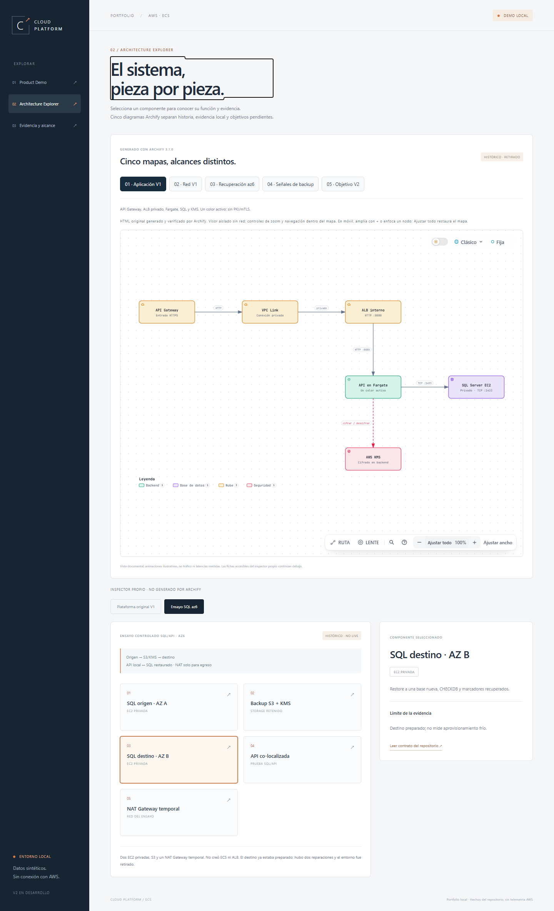

# Cloud Platform ECS · local portfolio

Product Demo, Architecture Explorer and evidence view. Plain HTML/CSS/JavaScript;
Node standard library only, no installation/build/backend credentials required.

From the repository root:

```powershell
node portfolio/server.mjs
# Or the existing workspace-local runtime:
& '..\..\.toolchain\node\node.exe' portfolio/server.mjs
```

Open http://127.0.0.1:4181. Ctrl+C closes the owned server normally. An occupied
port fails; the script never adopts or stops another server. It binds loopback
only. GET/HEAD serve an explicit asset/source allowlist; mutation routes and
arbitrary files are unavailable. CSP blocks network connections and external assets.

The message form uses memory-only synthetic text, never real KMS/SQL encryption.
Reload/reset restores examples. No localStorage, AWS mode, credentials, resource
controls, tracking, external fonts or third-party requests. User text uses textContent.

Architecture facts derive from terraform/docs/architecture.md and the recovery
runbook. V1 and az6 are distinct historical views: az6 did not create ECS/ALB.
Evidence preserves the controlled prepared-target 142.63 s RTO and its limits;
PKI/mTLS, Sentinel/email and full unchanged recovery remain pending. No live AWS
state is queried or asserted. Read-only source links expose only four fixed repo
documents, not an arbitrary filesystem browser.

Browser qualification uses already installed Playwright 1.64.1 and Chrome under
the separately authorized isolated local testing scope. No package/browser install:

```powershell
$env:PLAYWRIGHT_MODULE='C:\path\to\existing\playwright\index.mjs'
$env:CHROME_EXECUTABLE='C:\Program Files\Google\Chrome\Application\chrome.exe'
$env:UI_EVIDENCE_DIRECTORY='C:\path\to\new-owned-test-directory'
node portfolio/test-browser.mjs
```

The test starts its own server on an ephemeral loopback port and fresh browser
profile under the owned evidence directory, blocks external requests and closes
browser/server in finally. It never attaches to personal Chrome or reuses another
server/profile. It verifies synthetic CRUD/reset/XSS text handling, architecture
selection/scope, source links, historical/pending labels, mobile overflow and
desktop/mobile screenshots. A nonempty evidence destination refuses overwrite.
Unresolved teardown is reported; no PID discovery or forced cleanup is used.


## Provenance and bounded quality review

The component inspector is hand-authored and labelled separately. Five authentic
Archify-generated diagrams now complement it; their provenance and original
JSON/HTML are recorded in docs/interactive. No AWS live status is implied.

Keyboard navigation moves focus to the newly visible heading, offers a skip link
and native focusable buttons, names diagram groups/components and announces demo
message/validation changes. The browser test covers three views at 320/390/768px,
labels and focused navigation. This is a bounded functional review, not a complete
WCAG or assistive-technology certification. See ACCEPTANCE.md for remaining scope.


## Portable checks and CI source wiring

Run from the repository root with the existing Node 20+ runtime:

```text
node --test portfolio/test-contract.mjs
```

No browser, Playwright, EKS checkout, package install or external connection is
needed for this suite. Fourteen Node tests cover DEMO/history/provenance/data contracts,
navigation/accessibility source invariants, actual repository facts, allowlisted
GET/HEAD/CSP, mutation refusal, unintended files/encoded traversal and invalid or
external absolute targets. Negative inputs are in-memory copies; the HTTP cases
contact only an owned ephemeral 127.0.0.1 server that closes in the test after-hook.
Malformed/absolute request targets now return 400 rather than escaping the async
server callback or being accepted as proxy-form requests.

The new step in ci-repo-hygiene.yml runs this suite before the existing checks,
requires an already available Node 20+, installs nothing and adds no credential/
deployment permission. Unknown portfolio paths retain conservative existing CI
selection; no gate was narrowed or bypassed. Hosted workflows were not run.
Source-policy checks are regression guards, not an arbitrary-JavaScript sandbox
or substitute for the separate 14-check Chrome keyboard/mobile qualification.

Current local results: Node 14 PASS; CI selection 35 PASS; reproducibility 26 PASS and
one existing failure in test_dev_prod_aws_lock_identity_and_explicit_dev_provider_selection.
All 14 lock inputs and the original test source match base 0e08e5d. AWS blocks in
global/data/platform/apps/edge differ between DEV/PROD despite version 5.100.0.
No locks/pins were edited or test disabled. Full repo-hygiene is NOT green until
that independent baseline discrepancy is reconciled and the full checks rerun.
Actionlint was not available on the current PATH; no linter was installed.

The existing source inventory was updated only for the reviewed hygiene workflow
and new source-wiring test, retaining UNVERIFIED semantic disposition. The other
30 existing inventory findings remain unresolved; freshness hashes are not
security acceptance or permission evidence. No broad inventory refresh occurred.


## Authentic Archify diagrams - current

The demo now embeds [five official Archify-generated views](../docs/interactive/README.md)
above the separate hand-authored inspector. V1 and az6 are retired history, backup
signals are local replay, and the V2 integration map is explicitly pending. Original
Archify HTML/JSON, MIT credit and pins are retained; no upstream implementation is
vendored into the portfolio. The component inspector remains separate from generated diagrams.

The host keeps script-src self and connect-src none. Only five diagram routes get
an inline-script presentation CSP inside an opaque sandbox without same-origin;
links/private source metadata are removed and downloads are hidden. EKS's existing
camera adapter is reused with checked anchors; no EKS file/process was changed.
Node tests now total 14 PASS; integrated Chrome checks total 15 PASS, including all
five diagrams at 1440/390px with visible SVG nodes, zoom/reset and keyboard focus.
Three page views still pass 320/390/768px overflow/focus checks. No external requests,
console errors, dependency install, AWS or remote workflow. Full prior CI blockers
remain scoped; this does not certify full WCAG or whole-project acceptance.



[Mobile az6 overview](screenshots/archify-mobile.png) · [Acceptance](ACCEPTANCE.md)
