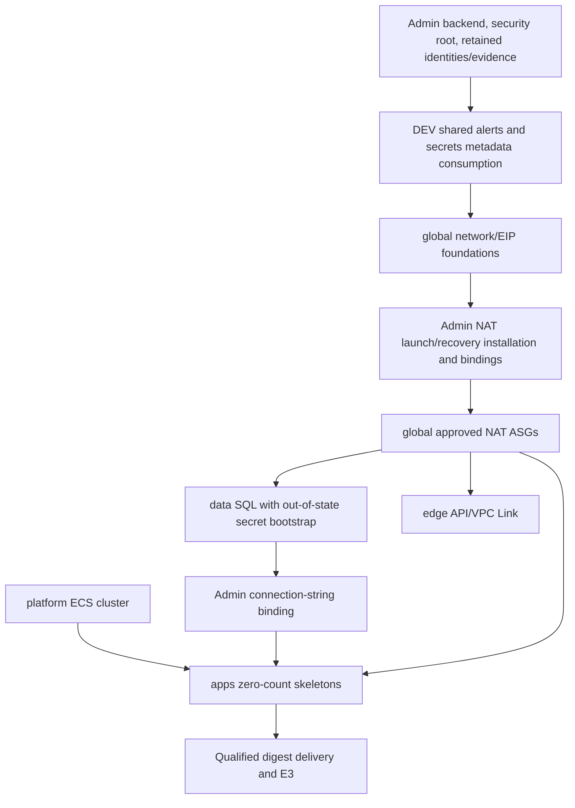

# E15 — DEV ephemeral lifecycle and teardown readiness

Original E15 repository increment; no AWS operations, including reads, were performed.
Initial main: `01f802b65d89d30c936feae438a147a234b9845d`. Work takes place on
`codex/e15-ephemeral-lifecycle` in the existing batch1 checkout, without new
worktrees or clones. **A complete live UP/DOWN cycle is not ready or proven.**

## What existed and what is missing

The project has protected **per-layer teardown** in
[WP5](e1-protected-environment-lifecycle.md), not a complete lab shutdown.
[Controller](../../scripts/lifecycle/controller.py) generates a destroy saved plan
only for approved high-risk `teardown`, validates exact installed addresses and
membership, requires both exact operator and environment/layer/revision teardown
approval, records intent before apply, and independently reads back afterward.
The installed [runtime](../../scripts/lifecycle/runtime.py) applies under
[E2 ownership](e2-environment-mutation.md). A repeated UUID returns retained
PLANNED/UNKNOWN/SUCCESS evidence; it does not repeat apply. This is implemented
repository authority with live installation absent, not an operational AWS claim.

[WP3](e1-internal-release.md) builds an approved immutable source through isolated
workers, publishes exact untagged neutral ECR content and protected manifest
versions, then independently qualifies it. [WP4B](e1-wp4b-normal-delivery.md)
deploys with current eligibility and E3 DB/KMS readiness. Prod promotion requires
independent approval; history rollback reauthorizes exact prior success. Emergency
recovery restores only accepted existing content. These mechanisms are reused.

Missing prerequisites for the requested `STATUS → UP → VERIFY → DOWN → VERIFY`:

- Backend/admin installation, protected packages/images/bindings, source approvals,
  state locks and genuine G1–G9 OIDC/governance are external and unverified.
- WP5 requires both colors and all running/pending tasks to be zero for teardown.
  Normal delivery requires positive replicas; cleanup scales only the **inactive**
  color and requires active capacity. Neither supplies a stop-active-color command.
- The public client supports ordinary read-only `plan` and protected mutation
  requests. It has no separately reviewable **destroy-preview** request/approval
  bound to an exact saved destroy plan. WP5 computes its plan internally after
  existing request approvals; that is not an operator-reviewed preapproval preview.
- NAT launch templates/functions/events, queues and permissions are security-owned.
  WP5 cannot retire them. Disabling events alone cannot settle already queued,
  checked or issued recovery calls; E13 retries and async execution need explicit
  admin quiescence. No new termination/takeover mechanism exists in E15.
- SQL has termination-deleted root storage and no accepted E5 backup/restore.
  Existing generic teardown approval is not a separately expressed SQL-loss policy.
- No global residual inventory or supported cross-layer automatic retry exists.
  E13 notifications also have a pre-existing topic identity mismatch described below.

[Retired WP7 sources](../../ci/authority/retired) are inert provenance. Direct
bootstrap/deploy wrappers reject execution. A legacy destroy script is not an
alternative authority. No parallel Terraform execution path is introduced.

| Capability | Classification |
| --- | --- |
| Existing build/qualification/deployment and per-layer WP5 gates | READY_IN_REPOSITORY; REQUIRES_LIVE_AWS_VALIDATION |
| Local STATUS, UP preparation, DOWN scope/risk preview and residual checklist | READY_IN_REPOSITORY (offline only) |
| WP5 teardown readback correction | READY_IN_REPOSITORY; REQUIRES_LIVE_AWS_VALIDATION |
| Complete DEV UP from genuine retained installation | PARTIALLY_READY; REQUIRES_LIVE_AWS_VALIDATION |
| Stop active tasks, retire NAT execution and bind a reviewed destroy plan | REQUIRES_OWNER_DECISION; PARTIALLY_READY |
| Interrupted E2/E4 owner handoff | PARTIALLY_READY diagnostics; administrative release remains blocked |
| Monthly budget/alert parameters | REQUIRES_OWNER_DECISION |
| Exclusive DEV SQL disposal with explicit confirmations | Approved owner policy; see [E15-B](e15b-dev-down.md) |
| Actual DOWN completion, residual absence and billing | REQUIRES_LIVE_AWS_VALIDATION |

## Ownership and dependency graph

Active roots: neutral `terraform/infra/security` with its admin wrapper;
`terraform/modules/target/{dev,prod}/{shared,secrets,global,data,platform,apps,edge}`.
Ordinary environment roots do not contain IAM/KMS/ECR/storage/security compute.
DEV `shared` means its alerts root, not authority to delete neutral/shared-account
resources. E15 retains both DEV shared/secrets roots and every protected dependency.
PROD and the security root are outside the proposed DOWN scope.



Layer dependency edges are derived from actual inputs: global consumes shared SNS;
data consumes global subnet/SG plus shared alerts and protected secret/profile;
apps consumes cluster, global subnet/SG/TGs, shared alerts and protected connection
binding; edge consumes global listener/subnets/VPC-Link SG. Platform is independent
of SQL/network for cluster creation; the selected deterministic order remains the
existing WP5 seven-layer order. Internal resource/module ordering is Terraform's
installed graph, never caller `-target` selections.

The [local helper](../../scripts/ephemeral_lab.py) enumerates every resource
**declaration** from active DEV/security source with owner, scope, risk, charging
dimension, retention, dependencies and reconstruction/absence checks. It fails on
unknown resource types. It also includes service-created/external dependencies.
This scan does not evaluate `count`, `for_each`, module expansion or actual IDs:
the ECS module is instantiated twice, NAT ASGs have two slots when genuinely
installed, and inactive protected maps create zero instances. Instance addresses,
counts, identity and destruction changes must come from genuine installed WP5
membership and saved plans, not declaration counts or Terraform examples.

| Relevant resources | Owner / scope; create dependencies | Proposed DOWN / residual costs / data risk / reconstruction | Future absence verification, using exact protected IDs |
| --- | --- | --- | --- |
| VPC, 4 subnets, IGW, route tables/associations, public route, 5 SGs/rules | global / DEV; VPC before children | WP5 candidate after every dependent service/ENI; transfer dependencies, not a promise of free networking | EC2 VPC/subnet/route/IGW/SG reads, complete child listings; reject permission errors as absence |
| Two allocated EIPs; two conditional NAT ASGs | global / DEV; network, approved launch templates and recovery bindings | Delete ASGs/instances before EIPs/network; EC2, EBS, in-use/idle IPv4 and transfer can survive partial deletion | AutoScaling exact groups/current members, EC2 instances/volumes/addresses; no allocated EIP may be omitted |
| NAT default routes, instance ENIs/root disks | WP4 runtime routes / service-created DEV dependencies | Quiesce handlers first; parent state removal is not child absence; dangling ENIs/routes block network removal | Exact ENIs, route next hops and root-volume mappings with complete independent enumeration |
| Internal ALB, 2 TGs, listener/candidate rule | global skeleton / DEV; VPC/subnets/SG | WP5 teardown only at quiescent runtime; ALB hours/capacity/traffic remain until deleted | ELB exact ALB/listener/rule/TGs and target memberships; no serving path remains |
| ECS cluster/capacity providers, 2 color services/inert task definitions | platform/apps / DEV; apps also require global + data + roles | apps before platform; Fargate and Insights/logs may continue until all tasks stop | Exact cluster/services and complete RUNNING/PENDING task enumeration, task ENIs/target memberships |
| WP4 registered runtime task revisions | delivery / DEV | Retain references and immutable evidence; no arbitrary deregistration path; revisions alone do not imply running-task cost | Exact revisions plus full running-task/operation inventory; distinguish inactive definition from active task |
| HTTP API, integrations/routes/stage, VPC Link and service-created ENIs | edge / DEV; global listener/subnets/SG | Remove edge first; requests/transfer/logs and remaining ENIs require review | API Gateway exact IDs, integrations/routes/stages/links; EC2 ENI absence before global |
| SQL t3a.small instance, 30-GiB default gp3 encrypted root EBS | data / DEV; private subnet/SG, protected AMI/profile/passwords | Root `delete_on_termination=true`: loss of SQL data; EC2/EBS can survive partial DOWN; recreate only after explicit data policy | Exact instance, termination completion, all mapped/orphan volumes and any owner-approved snapshots |
| Environment ECS/API/VPC logs, metrics and E7 alarms | apps/edge/global/data / DEV | Owning layer teardown deletes these logs/alarms; export any needed diagnostics first; retained logs/custom metrics elsewhere still bill | Exact Logs groups/streams/retention and CloudWatch alarms/metrics; archive before deletion if needed |
| SNS topic/subscription `demo-dev-shared-alerts` | shared / DEV | **Retain** for ongoing residual/control alerts; request/notification usage; confirm subscription; recreates only via existing WP5 | Independently inspect actual ARN, subscription and delivery; not an E15 deletion target |
| Secret metadata, SQL/task/exec/NAT IAM/profile, KMS keys/aliases | security / DEV and PROD (separate bindings) | **Retain**; secret/key months and requests; losing keys can invalidate stored encrypted data; admin-only reconstruction | Exact secrets/key/role/profile identities, access policies and versions; never delete through DEV lifecycle |
| Application and controller ECR repositories/images | security / neutral, DEV/PROD and installed controllers | **Retain** all E8 images; unbounded image bytes; no cleanup/tag removal path | Exact account/repository/digests/policies and genuine pulls; manifests do not prove image presence |
| S3 release evidence, bundles, quarantine, WP4 coordination and WP5 state/requests | security / neutral and per-environment | **Retain** evidence, heads, terminal records, object versions and locks; bytes/requests; quarantine expiry is existing contract only | Exact bucket/prefix/version inventory; do not delete state before or after DEV DOWN here |
| External security backend and native S3 locking | separately authenticated admin / account | **Retain** for reconstruction; state/versions/requests; distinct from seven DEV state keys | Genuine admin backend binding/policies and existing locks; no force-unlock or state removal |
| Lambda gateways/finalizers/cleanup/NAT, EventBridge rules/targets/invoke permissions | security / neutral or fixed DEV/PROD binding | **Retain** installation/evidence; separately quiesce relevant DEV events/in-flight work; invocation/log/image cost can remain | Exact function/version/rules/targets, outstanding async work and authenticated executor termination/issued-call settlement |
| E13 delivery/execution SQS failure queues, policies and backlog alarms | security / per-env DEV/PROD | **Retain**, 14-day message retention and `prevent_destroy`; admin archive/drain; requests, backlog and diagnostic bytes | Exact queue attributes/messages/destinations and CloudWatch alarms; no automatic replay/redrive |
| CodeBuild projects, logs, IAM/OIDC and service-linked roles | security / neutral and fixed environment | **Retain** control plane; no always-running CodeBuild compute but build minutes/logs/artifacts persist | Exact project/build inventory and terminal status; no new job starts during quiescence |
| Any existing approved snapshots/backups | separately approved owner scope | **Retain**; storage may bill; E15 implements neither E5 backup nor deletion | Independent exact snapshot/backup inventory, ownership and restore evidence |

## Operator commands (local only)

From the feature checkout, substitute the intended account/region; these inputs
are context labels, **not** STS-authenticated identity or AWS permission evidence:

```text
python -I -B scripts/ephemeral_lab.py status --account <12-digit-account> --region <region>
python -I -B scripts/ephemeral_lab.py up-prepare --account <account> --region <region>
python -I -B scripts/ephemeral_lab.py down-preview --account <account> --region <region>
python -I -B scripts/ephemeral_lab.py down-preview --account <account> --region <region> --confirm-dev-destruction --sql-policy DISPOSABLE --confirm-sql-data-loss
python -I -B scripts/ephemeral_lab.py verify --account <account> --region <region> --notes <local-audit-notes.json>
python -I -B scripts/ephemeral_lab.py residual --account <account> --region <region> --notes <local-audit-notes.json>
```

Exit zero means **local report rendered**, never UP/DOWN SUCCESS. Missing/corrupt,
foreign or unknown notes fail closed or add blockers. A versioned E2 head in local
notes is still untrusted: even all resources marked ABSENT cannot grant authority,
prove freshness or produce AWS-verified completion. Reports always say
`execution_authorized=false`, `aws_verified=false`. `down-execute` rejects even
with both confirmations. No OIDC/SDK/subprocess transport exists in this helper.
The existing [WP6 client](../../scripts/workflow_requests/client.py) remains the
future authorized request/status path; do not invoke it during this task.

Local notes use the closed `E15_LOCAL_NOTES_V1` shape: environment/account/region,
all three E2 domains `{version_id, head}`, operation notes
`{binding, operation_id, state, layer}`, and a map of emitted inventory keys to
PRESENT/ABSENT/UNKNOWN/PARTIAL. Unlisted resources remain UNKNOWN. Use `layer=null`
for delivery/recovery, exact layer for lifecycle. Notes record diagnostics only;
no synthetic sample is an installation, live observation or approval.

## UP: gated reconstruction from retained baseline

1. STATUS: review local declared scope, then in a **future separately authorized
   AWS session** verify caller/account/region, genuine protected source revision,
   admin backend and lifecycle state/lock identities. No automatic fallback.
2. Establish the admin-only backend/security root and service-linked roles if
   absent. Install reviewed controller packages, exact image digests and provider
   mirror/tool identities. Publish genuine VersionIds/readbacks/current membership;
   establish G1–G9 and exact WP6 workflow pins. All canonical maps remain inactive
   here; fixtures must never fill them.
3. Retain or create DEV shared alerts and secrets metadata consumption through
   ordinary WP5. Confirm actual alert subscription/publication. Write SQL password
   values through existing explicit admin bootstrap, outside Terraform state.
4. Use protected plans and accepted WP5 create/reconcile in order:
   **shared → secrets → global → data → platform → apps → edge**. Global first
   creates network/EIP foundations without NAT ASGs; admin then establishes exact
   launch/recovery installations and fresh network/member bindings before approved
   ASG creation. This is an interleaved reconstruction gate, not one graph-wide apply.
5. Data requires exact SQL AMI/profile/password readiness and separate high-risk
   request approval. After genuine DB binding, admin publishes connection-string
   values/binding out of state; only then create high-risk zero-count apps.
   Platform/edge use their approved ordinary bindings. Refresh protected IDs after
   recreation: old subnet/cluster/instance ARNs and retained evidence are not current
   membership. `create` cannot mutate existing resources; installed `reconcile`
   cannot replace execution bindings. Select the approved operation, not a fallback.
6. Approved source → protected release build → independent qualification → current
   eligibility → protected dev delivery → E3 DB/KMS readiness/exact cohort → routing.
   Reuse a retained qualified digest only if all current qualification/eligibility/
   manifest/version/availability/runtime bindings authorize it; no forced rebuild
   or arbitrary historical rollback promise.
7. VERIFY: retain operation receipts and exact task/route/network observations,
   successful real application/readiness/SQL/KMS evidence and private-subnet NAT
   forwarding. E13 CONFIGURED is not end-to-end egress proof. Only genuine current
   readbacks and successful protected operations establish a live UP state.

## DOWN: prepared scope, execution still gated

1. Freeze new dev requests operationally; collect protected current bindings,
   inventory/state versions, all E2 heads and operation journals. Do not touch prod,
   shared-account authority, protected evidence or backend. A historical SUCCESS
   does not prove current state or executor settlement.
2. ACTIVE, UNKNOWN, UNCERTAIN, interrupted E2 owner or incomplete E4 blocks progress.
   E2-R diagnostics do not prove executor termination or remote settlement. Never
   force-unlock, reset/delete a head, advance generation manually or use a new UUID
   to escape an attempted apply. Existing status/retry reuses evidence only.
3. Obtain independently explicit consent for DEV resource destruction **and** SQL
   root-data loss. `DISPOSABLE` is an owner decision, not implied by the word demo.
   Choosing PRESERVE blocks until a separately approved snapshot/backup and tested
   restore contract exists. Confirm log export/retention if diagnostics are needed.
   No image deletion or evidence/state removal is part of this consent.
4. **Missing authority gate:** safely bring both ECS colors to desired/running/
   pending zero and establish complete task absence, without bypassing WP4/WP5.
   Existing cleanup cannot stop active service; do not call UpdateService manually
   under another role. An approved quiescence increment or separately bounded
   authenticated administrative procedure is required before real DOWN.
5. **Admin execution-settlement gate:** retire/freeze relevant DEV NAT launch/event
   and cleanup activity and verify exact function executions, queued async retries
   and potentially issued API effects have settled. WP5 cannot change their code,
   permissions, events or launch templates. Preserved stale memberships fail closed
   but cannot prove an already-issued call has ended. E13 queues remain protected.
6. **Destroy-preview gate:** obtain a genuine protected destroy plan per layer,
   display exact deletions and sensitive-data effects, then approve that exact
   request/revision/plan under an accepted authority. Existing read-only plan is
   not destroy-preview; the local declaration report is not that plan. E15 does
   not add a new preview/approval endpoint or counterfeit approval bytes.
7. After all missing gates are genuinely supplied, use only approved high-risk
   WP5 teardown requests in **edge → apps → platform → data → global** order.
   Wait for verified result/current residual evidence before advancing. The order
   removes VPC Link/tasks before network, cluster after services, SQL before subnet,
   and retains shared/secrets for alarms/metadata. Terraform orders children inside
   each saved plan. E2 ownership spans each operation, not a whole multi-layer
   transaction: no continuous batch lock or guarantee against an intervening deploy
   is invented. Recheck current heads/membership/quiescence before each step.
8. Partial execution is UNKNOWN/UNCERTAIN, not successful DOWN. Stop, preserve
   state/locks/journals and diagnose. Retry only retained status for the same UUID;
   an additional plan/apply is a separately authorized operation after authenticated
   effect settlement. Do not continue subsequent layers or issue broad cleanup.
9. VERIFY/RESIDUAL: independently enumerate exact intended IDs, service-created
   children and unexpected/orphan resources; record uncertainty and residual cost
   dimensions. Preserve seven state keys/versions and evidence for reconstruction.
   Terraform-state emptiness alone does not prove account-wide absence or zero bill.

## WP5 readback change and authority preservation

Previously, a no-op refresh could describe surviving managed resources and still
pass verification. Conversely Terraform 1.13.4's truly empty refresh plan omits
`resource_changes`, so the old generic check rejected its empty shape. The new
teardown-only verification requires `complete=true`, `errored=false`, no drift/
deferred work, a complete recursively empty managed-values tree, no contradictory
managed changes and a fresh exact ECS quiescence observation. It supports the
actual empty `planned_values.root_module={}` shape verified provider-free. Missing,
corrupt, partial or nonempty readback cannot complete SUCCESS. The existing
controller retains UNKNOWN and E2 holds when mutation was attempted.

Create/reconcile verification and public WP5 request/approval contracts remain
unchanged. No IAM/trust/PassRole, generated resource configuration, WP4D packages,
E1 qualification/E3, E2 generations, E2-R or E4 authority changes. Only eight
WP5 package hashes change mechanically. E8's baseline authority assertion now
excludes these independently checked package identities as well as WP4D hashes;
its original policies, risk reproduction and protected-resource fingerprint remain.

## Residual cost and budget baseline

UP cost model: retained baseline + SQL EC2/EBS + two NAT EC2/EBS/public IPv4 +
Fargate task time + ALB hours/capacity + requests/transfer + logs/Insights/alarms +
release/controller CodeBuild/Lambda usage. DOWN model: retained S3 object versions,
ECR image bytes, KMS keys, Secrets Manager, control logs/alarms/queues/notifications,
any snapshots/backups, plus **every surviving** instance/volume/EIP/ALB/task/service.
Use actual region/time/quantities and owner-reviewed current rates later; no price,
monthly number, free-tier entitlement or $0 guarantee is invented. Idle allocated
public IPv4 still has a charging dimension ([AWS VPC pricing](https://aws.amazon.com/vpc/pricing/)).

The [budget draft](../../ci/ephemeral/budget-draft.json) leaves monthly_limit,
currency, actual_percent, forecast_percent and scope null and recipients empty.
Owner supplies positive decimal strings and explicit recipients/scope before
installation. The helper validates actual/forecast warning parameters without
creating AWS Budgets, SNS, IAM or a shutdown action. Account-total scope catches
untagged/shared residual charges; DEV-tag scope additionally requires explicit
residual review and does not establish an account cap. No scope is owner-approved
by default. Budget warnings can lag expenditure and are not a hard billing limit
([AWS Budgets](https://docs.aws.amazon.com/cost-management/latest/userguide/budgets-managing-costs.html)).

E7/E13 metrics/alarms are reused as existing signals, not invented notifications.
**Observed source mismatch:** shared creates `demo-dev-shared-alerts`, while E13
alarm_actions name `demo-dev-alerts` (and analogous prod names). No matching E13
SNS declaration exists in these roots. Notification target/publication needs a
separately accepted correction/admin binding and genuine subscription/KMS/service
publication/delivery checks before installation; E15 records the blocker without
changing protected authority. Lifecycle failure visibility uses retained WP5 public
result/CodeBuild status and E2-R diagnostics; general lifecycle failure alerting is
not currently implemented. Owner alert delivery configuration remains pending.

If DOWN is incomplete: stop progression; preserve holds and evidence; list residual
resource IDs, owner, charging dimension, observed state, observation source/time,
next approved diagnostic action and owner disposition in a private audit register.
Update the budget/residual review and notify through the owner's separately chosen
channel when genuinely installed. E15 sends no messages and starts no service.

## Validation and pending decisions

Focused entry points: `python -I -B scripts/tests/ephemeral/run.py` and
`python -I -B scripts/tests/ephemeral/check_plan_shape.py`. Both are included as
additional checks in the existing E1 gate, preserving its 983 E1/WP count. The
shape check uses Terraform 1.13.4 on a disposable **provider-free**, backend-free
empty configuration without init; it never executes an AWS plan/apply/destroy.
Tests cover DEV identity, prod/shared isolation, graph order, backend retention,
independent confirmations, E2/E4 holds/interruption, missing/corrupt notes, partial
managed state, safe retained retry, implicit residues, ECR persistence, budget
parameters and unchanged authority/inactive maps.

Remaining owner decisions after [E15-B](e15b-dev-down.md): log export
needs; monthly budget/actual/forecast thresholds/recipients/scope; bounded active
service quiescence, destroy-preview approval binding and admin NAT/executor
settlement procedure; notification identity correction. These gates cannot be
replaced by local reports, fixture records, elapsed time or weaker credentials.
Live installation/provider schemas, real bootstrap, readbacks/quiescence, network/
application checks, teardown child-resource absence, pulls/reconstruction and
billing/notifications remain REQUIRES_LIVE_AWS_VALIDATION.


Local acceptance on 2026-10-12: `E1_REPOSITORY_ACCEPTANCE_PASS`, all 983 E1/WP,
41 E2, 28 E4 and 23 E2-R tests passed with no failures/errors/skips, and AC1–AC16
passed. All fifteen gate checks passed, including 30 E15 tests, actual empty
Terraform 1.13.4 plan shape, E8 (18), E13 (40), exact security/workflow generation,
source inventory/Python/JSON parsing, deterministic packages, provider-free
NAT/E2/WP4D/WP5/WP6 policy/trust/PassRole/installation expressions, KDD links,
immutable approved contracts, check-only Terraform formatting and diff whitespace.
Separately E7 (8), E11 (33), and E14-B (19) passed. The actual local CLI was
exercised inside the hermetic guard: five report modes emitted 217 inventory
entries without AWS authority, and DOWN/EXECUTE rejected both confirmations.

Local Ubuntu TFLint 0.64.0 returned exit 2 with the same 24 accepted warnings;
tfsec 1.28.14 returned exit 1 with the same 46 accepted findings. Rule, file,
resource where applicable, severity, meaning and multiplicity matched the existing
accepted Batch 2 report; no additions/removals, suppression or soft-fail. The
bounded self-check confirmed 174 Terraform/HCL files unchanged from initial HEAD
and authority unchanged except eight source-derived WP5 package hashes. No new
worktree/clone/repository copy, remote Git, AWS call, provider init, dependency
installation or deployment occurred. Reports reside outside the repository in
`e15-final-acceptance`, `e15-lint` and `e15-local-reports` under the local temporary
directory. The unchanged .NET application suite was not rerun; its prior 99-test
baseline is not claimed as fresh E15 execution. No mock establishes live teardown.

Current continuation: [E15-B](e15b-dev-down.md) records the approved exclusive DEV
SQL loss policy and protected per-operation confirmations, local artifact review,
same-invocation binary/context seal and fresh pre-apply ECS readbacks. Earlier SQL
policy gaps above describe the original E15 assessment. ECS closure, NAT settlement
and protected reviewed-plan handoff remain blockers; DOWN/EXECUTE remains denied.
